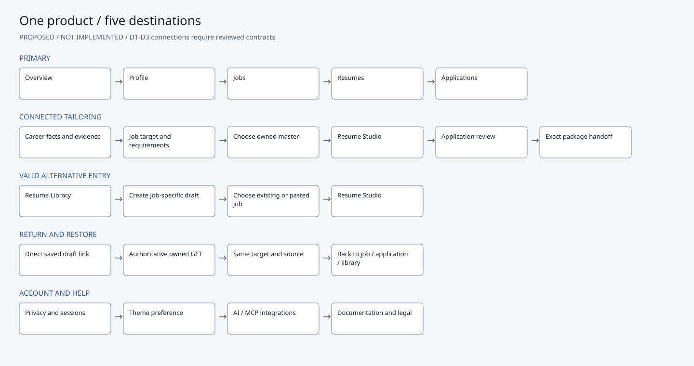
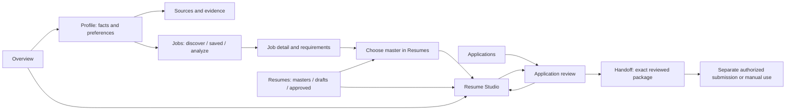
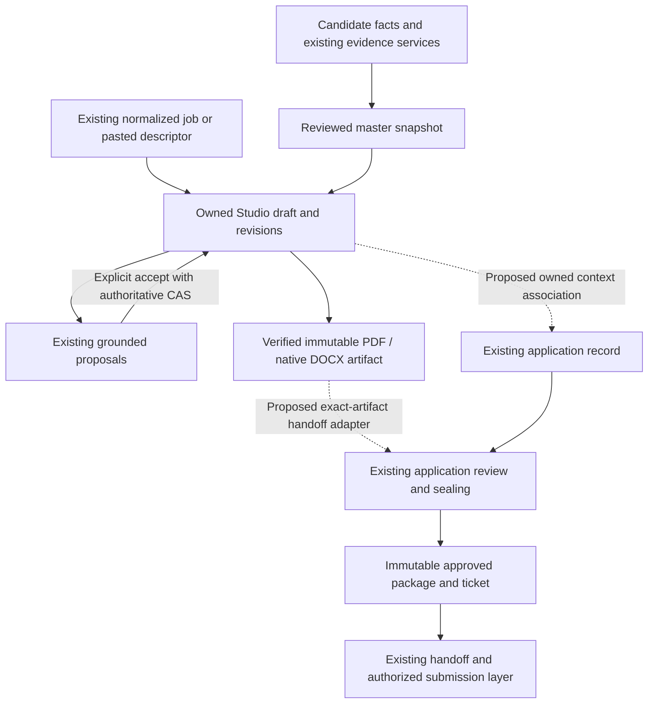
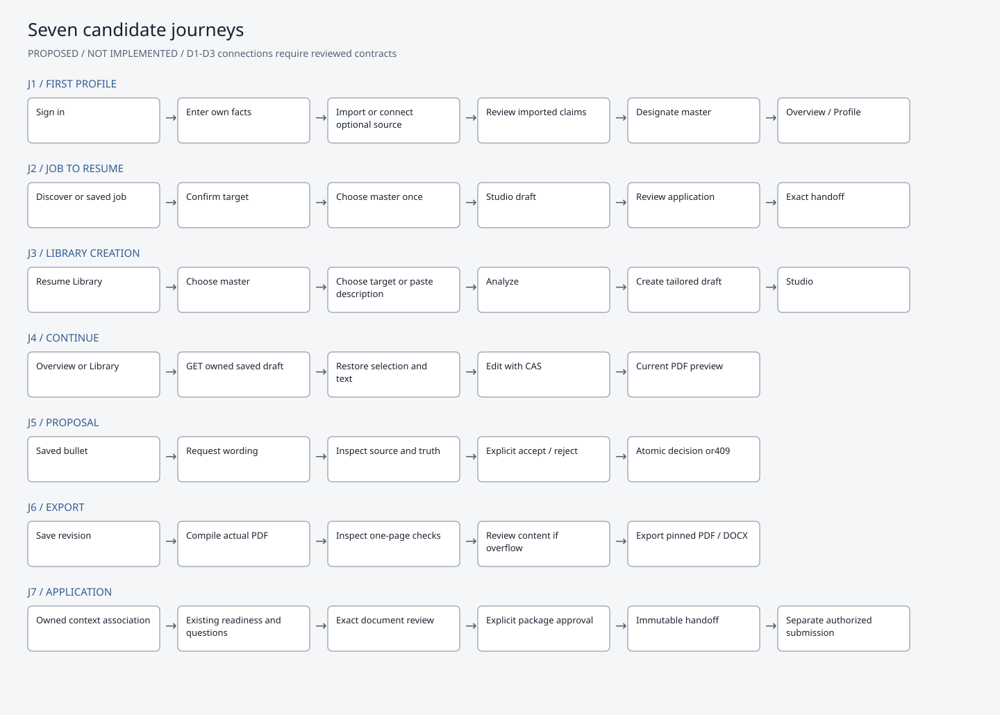

# Career Hub + Resume Studio: unified product proposal

**DESIGN-UNIFIED-001 / v1.0 / 2026-10-15 / PROPOSED — APPROVAL PENDING**

Planning and design review only. No application implementation, schema changes, migration, Git checkpoint, merge, copy between worktrees, deployment or production action is authorized by this document. The separate review folder contains evidence and static wireframes only. No worktree or project ledger is edited; a proposed ledger entry accompanies this plan because the explicit read-only instruction takes precedence over the usual ledger-update protocol.

## 1. Recommended direction

Make Career Hub one candidate workspace with five primary destinations: **Overview, Profile, Jobs, Resumes, Applications**. Resume Studio is the focused editor inside Resumes, reachable directly from a job, a master resume, an application or a saved draft. It does not get a second account system, candidate model, generation engine or independent product navigation.

Use one restrained visual system with light and dark themes, existing Inter typography, existing SVG icon vocabulary, consistent controls and semantic states. Keep the document white in both themes. Replace repetitive dashboards and architecture banners with clear next actions and inspectable details. Preserve functionality rather than hiding it to achieve a sparse screen.

The first engineering priority after approval is context integration, not a new skin alone. Draft listing, reusable job targeting and exact Studio-document binding into application review/handoff are prerequisites for the proposed connected journey.

## 2. Evidence, scope and verified baseline

### Inputs examined

- Main `AGENTS.md`, `goal.md`, `project.md`; integrated ledger and current PRD repair roadmap.
- Original BLUEPRINT-2026-001 and UIUX-BLUEPRINT-2026-001; approved Antigravity desktop/mobile prototype references and prototype source.
- Competitive artifacts: `verified_feature_catalog.md`, `actual_resume_benchmark.md`, `reactive_resume_runtime_trace.md`, `rezi_product_specification.md`, and the research-closure ledger entry. These are historical research inputs, not new live competitor evaluations. Feature-catalog implementation statuses predate the integrated Studio and are not adopted as current fact. Competitor prices and proprietary score claims are not requirements.
- Current Studio contracts 1.0 analysis, 1.1 drafts, 1.2 proposals, 1.3 documents/history/diagnostics/approval, their executable schemas, fixtures, integration handoff and local-visibility report.
- Current app routes, layout, CSS, profile/readiness, Radar, library, Studio, application-review/handoff source and existing persistence/approval adapters.

The goal's Phase0 footer is stale relative to the execution ledger's Phase14/16/17 work. This proposal follows the unchanged provider-neutral, evidence-based mission and the explicitly authorized product refinement, without rewriting strategic documents or inventing completion percentages.

### Runtime and repository evidence

| Surface | Verified state | Interpretation |
| --- | --- | --- |
| Main checkout | `C:\Users\VISHW\OneDrive\Desktop\Ai-career-agent`, branch `main`, HEAD890bcf03ed37bff11a912e68c1c7ee37c21f401a | Original application preserved; port3000 currently refuses connection |
| Integrated checkout | `C:\Users\VISHW\AppData\Local\Temp\career-resume-studio-backend`, branch `backend/resume-studio-20261014`, same HEAD | Running at127.0.0.1:4317; includes actual Studio frontend and APIs |
| Frontend checkout | `C:\Users\VISHW\AppData\Local\Temp\career-resume-studio-frontend`, branch `frontend/resume-studio-20261014`, same HEAD | Earlier UI work preserved; not the complete integrated application |
| Common repository | All three registered worktrees, same baseline | No merge assumed; valuable uncommitted changes remain |
| Source equivalence | Twelve main page templates byte-identical between main and integrated checkout | Career Hub's rendered pages on4317 are valid visual references for those original templates; shared layout/navigation changes are explicitly different |
| Browser audit | Twelve authenticated top-level routes plus two source-detail captures return200 | Desktop1440×1000 and mobile390×844 inspected; the two detail captures resolve the same owned source document |
| Additional states | Seven Profile/Radar GET states return200, plus stored proposal/source/history and account/mobile navigation captures | No business actions performed; some Profile aliases are retained by existing navigation |
| Business mutations | No edits, generation, approval, application creation or submission requested | Normal login creates a session. Two cached preview POSTs only reread an existing immutable document; its ID and revision2 remain unchanged |
| Existing acceptance | Prior500-case integration and39-case navigation gates documented | Historical evidence, not rerun or relabeled as design-review test results |

This review uses the disposable synthetic candidate. There are no connected repositories, live-job results or application records. Source-document bytes are fixture placeholders while canonical structured master data is seeded separately; the zero parsed-sections screen is not evidence of a parser failure on real uploads. Live discovery, source import, populated application review, handoff, external submission, live AI and Office DOCX pagination are **NOT VERIFIED in this audit**. The earlier Office-rendering blocker remains.

Current screenshots are real Chrome renders in `current-screens/`; `browser-audit.json` records status, controls, links, overflow and theme behavior. Proposed SVG/PNG boards in `wireframes/` are clearly marked **NOT IMPLEMENTED**. They illustrate structure and example states, not working routes or fabricated verification results. No hosted design service, generic image mockup, tool installation or code-generation integration was used under this read-only scope.

## 3. Current-state audit

Status meanings: **WORKING** = directly observed within this read-only surface; **PARTIAL** = visible with missing connection or limited evidence; **BROKEN** = reproduced presentation defect; **NOT VERIFIED** = unavailable state or prohibited operation. They do not imply production readiness.

| Screen | Evidence/status | Findings and consequence |
| --- | --- | --- |
| Overview `/dashboard` | WORKING rendered; actions not executed | Greeting/workspace identity dominates. Several links perform job discovery; empty jobs/apps consume large cards. Dashboard shows75% readiness and0 issues while Profile shows44% ready,85% populated and5 issues. These are different heuristic scopes, not necessarily fabricated numbers, but the current presentation suggests one inconsistent measure. No visible continue-Studio-draft action. |
| Jobs `/apps/radar` | PARTIAL, empty synthetic dataset | Discovery, Saved Pipeline and Custom Analysis exist. Main copy calls fit an ATS score; source contains a saved-card default75 fallback that also replaces a legitimate zero. Populated saved-card behavior not run. No directly integrated Studio entry observed. Provider-unavailable and genuinely empty results are not clearly distinguished in the rendered empty state. Custom Analysis advertises minimum50 characters versus Studio's100; a shared targeting interface must preserve endpoint-specific compatibility. |
| Radar mobile | BROKEN presentation | Custom Analysis tab is clipped at390px; root horizontal overflow reproduced. Rewrapping/scrollable local tabs must preserve all three actions. |
| Profile `/profile` | WORKING display, saving not tested | Six local tabs and multiple readiness representations. Five missing items repeat in separate panels with Add, Fix and Add-arrow actions. Raw `HANDOFF_READY`, `workAuthorization` and `visaSponsorship` leak into candidate copy. A general Verified tag covers a completeness checklist; completeness is not proof of qualifications. |
| Skills `/skills` | PARTIAL | Four colored aggregate cards, technical taxonomy pipeline and zero-citation confidence50% for a claimed React skill. Truth categories are useful; percentages and technical classifications require explanations and should not dominate. A GitHub profile link does not mean a connector is connected or a claim verified. |
| Projects `/projects` | PARTIAL, empty | Large AST pipeline, empty-state card, multiple connect/ingest actions. Imported resume projects visible in Studio are distinct from repository-derived portfolio records; confusing if both surfaces are presented as one project inventory without source labels. |
| Sources `/sources` | WORKING display, connector operations not tested | Resume view/download/replace overlap Library. GitHub permissions/revocation are valuable. Technical security labels occupy primary space, and “automatically verify your technical skills” overstates what merely connecting a resource proves. |
| Resume Library `/resumes` | PARTIAL | Uploaded master and version history work as a rendered archive. It is hidden in the account dropdown rather than primary navigation. Persistent Studio drafts are absent; no owned draft-list API exists. Active source, upload and history repeat identity/security cards and document actions. |
| Source review `/resumes/:id` | WORKING fixture display only | Clear candidate-claim distinction exists. Hash/MIME/file metadata dominate above source review. Review & Promote is technical terminology; use Review imported facts. Empty fixture parsing is not a production parser diagnosis. |
| Studio `/resume-studio?draftId=…` | WORKING inspected current draft/artifact; editing not repeated | Neutral editorial theme and real compiled PDF are strengths. Form, selection, source inspector, proposals, diagnostics, history and exports exist. Main blue/purple shell and Studio charcoal token family diverge. Two large score cards compete with preview;100% lexical coverage beside28.63 job fit needs clearer meaning. Repeated Claim tags and top explanatory cards consume writing space. |
| Studio context/persistence | PARTIAL integration | Deep-link restoration exists, but Library cannot list drafts. Target parsing is duplicated with Radar; the analysis form can analyze another target while the existing draft's immutable target remains the original. This is a source-observed context risk, not a mutation performed here. Approval response returns applicationId, but client records only local approval state and does not provide a completed return-to-application journey. |
| Studio mobile | WORKING no overflow; usability issue | Long stacked content puts the preview far below the editor. A user must scroll a great distance between a field and its actual PDF. Adopt one compact Edit/Preview/Checks mode selector without duplicating it above and below. |
| Applications `/applications` | WORKING empty state; populated NOT VERIFIED | Lifecycle banner highlights Interviewing with no records. Five zero-value statistics repeat filter counts. Track Application/Find Jobs actions duplicate header and empty-state actions. Preparing, reviewed package and submitted status need different treatment. |
| Application review `/applications/:id/apply` | SOURCE-INSPECTED; populated NOT VERIFIED | Existing readiness/conflict/question/review flow is valuable. Do not replace it with another Studio wizard. Source uses an ATS Alignment/Verified Claims line and expects its existing resume/package representation. Studio approval alone does not prove screening answers or attachment adapters are ready. |
| Handoff `/applications/:id/handoff` | SOURCE-INSPECTED; populated NOT VERIFIED | Existing package history, regeneration, snapshots, preview and approvals must remain. Duplicate regenerate controls and document operations can be consolidated. No verified adapter consumes Studio's exact PDF/DOCX bytes throughout the legacy handoff/download flow. Do not show a newly regenerated substitute under an old approval. |
| Onboarding `/onboarding` | WORKING first step; later steps NOT VERIFIED | Five steps foreground GitHub and engineering domains. Import/master review should be a clear valid path; authorized resources remain optional and provider-neutral. “Verified career profile” before evidence review is overconfident. |
| Settings `/settings`, AI Connect `/connect` | WORKING display only | Privacy/session/token/revocation functions are important. Repeated identity/tier cards and protocol diagrams are excessive for routine account management. Keep MCP configuration under advanced integrations. No tokens generated, copied into reports or revoked. |
| Global shell | PARTIAL | Brand link leads to public root rather than authenticated Overview. Library/skills/projects are buried in the account menu; Sources is primary while Studio is a separate primary destination. Back to Dashboard is used regardless of origin. Long marketing/technical footer repeats navigation and has competing branding “Career Hub”/“AI Careers Hub.” |
| Themes/accessibility | PARTIAL | No current light theme or theme control found. Both preferred-light and preferred-dark browser renders stay dark. Source has many `transition:all` declarations, no observed reduced-motion rule/skip link, and a mouse-only divider without semantic keyboard separator behavior. Studio's keyboard tabs/drawer focus behavior already exists and should be preserved. Full WCAG conformance not assessed. |

### Highest-priority changes

1. Put all resume work in a discoverable Resumes destination, backed by an owned list of existing drafts and approved versions.
2. Bind job, master, draft and associated application context across screens; eliminate re-pasting job descriptions and regenerating a different resume during handoff.
3. Replace contradictory readiness displays with scoped, actionable checklists. Never supply a default fit score when data is absent.
4. Unify theme/component tokens and give mobile Studio direct access to Edit/Preview/Checks.
5. Consolidate decorative/technical/repeated UI while keeping evidence, source history, privacy, error recovery and approval capability reachable.

## 4. Information architecture and navigation

The diagram describes the proposed experience. It does not imply that missing context adapters exist.

| Destination | Contents | Existing paths retained |
| --- | --- | --- |
| Overview | Current draft, next actionable item, recent jobs/applications; helpful first-use checklist | `/dashboard` |
| Profile | Facts/contact/experience/education; skills/projects; sources; job/screening preferences | `/profile`, `/skills`, `/projects`, `/sources`, `/onboarding` |
| Jobs | Discover, Saved, Analyze description, target detail/requirements | `/apps/radar`, `/jobs` alias, existing analysis flow |
| Resumes | All, Masters, Drafts, Approved; import/source review; focused Studio | `/resumes`, `/resumes/:id`, `/resume-studio?draftId=:id` |
| Applications | Preparing, Submitted/Screening, Interviews, Offers/Closed; readiness/questions/review; handoff/history | `/applications`, `/applications/:id/apply?step=…`, `/applications/:id/handoff` |
| Account/Help | Theme, privacy/data controls, sessions, AI/MCP integrations, documentation/support | `/settings`, `/connect`, `/docs/mcp`, existing legal/help routes |

No immediate route renaming. Primary nav becomes five items; contextual Profile tabs expose Sources, Skills and Projects without deleting their deep links. Resumes is active while Studio is open. Global assistance becomes contextual where it adds value; `/assistant` and MCP integrations remain available. Navigation itself does not create or mutate business records.

### Breadcrumb and return rules

- Overview is the authenticated brand destination. Existing public landing remains accessible outside candidate workspace navigation.
- Library entry: **Resumes > Frontend Engineer / Synthetic Systems > Studio**, return **Back to Resumes**.
- Job entry: **Jobs > Frontend Engineer / Synthetic Systems > Resume**, return **Back to job**. Preserve job search/filter/tab state in a validated same-origin return path.
- Application entry: **Applications > Frontend Engineer / Synthetic Systems > Resume**, return **Back to application**. Use an authoritative associated application ID, not a caller-supplied ID as proof.
- Direct draft link/reload: fetch owned current draft by ID. Default return is Resumes when origin is absent; derive job/application links from owned server metadata. Do not depend on browser memory for discovery or restoration.
- Keep only one origin-return control plus hierarchy breadcrumb; remove universal Back to Dashboard links from every detail screen.
- If saving is pending, drain the acknowledged save before leaving. On offline/error/conflict, preserve local edits and offer Stay or explicitly leave with unsaved changes. No silent discard or blanket overwrite.
- Sign-in preserves the safe internal draft link;401 recovery must not lose context. Foreign/nonexistent resources remain indistinguishable404. Malformed context fails safely; no open redirect or tenant/owner query parameter.

## 5. Source-of-truth and integration map

| Entity | Authority today | Proposed frontend use and boundary |
| --- | --- | --- |
| Candidate/account | Existing users/candidates, candidate career-profile service and normalized profile metadata | One identity/fact/preference editor. Account display name can differ from resume identity; show and resolve meaningful application conflicts explicitly. No Studio candidate store. |
| Evidence/claims | Existing authorized resource/evidence/claim-validation services and truth taxonomy | Candidate-reported is not independently verified. Hashes prove integrity, not qualification truth. Connecting a repository or listing a profile URL is not verification. |
| Master source | Owned `resumes` original encrypted bytes plus candidate-reviewed `resumeData` bound to sourceResumeId/sourceVersion | Immutable source snapshot for each clone. New source approval/profile updates do not silently rewrite existing drafts/packages. Sources manages connection state; Library manages document versions. |
| Job target | Existing Radar/application job records and normalization; Studio's deterministic `JobDescriptionParser` and immutable bounded jobTarget/jobDescription snapshot | One targeting component/read model reuses existing normalized data. No new parallel “Studio jobs” store. Source URL is metadata; Studio does not currently fetch URL-only descriptions. |
| Tailored draft | Existing encrypted Studio draft/revisions, server node IDs, selection and content hashes | Canonical current revision is server-owned. Frontend holds acknowledged snapshot plus transient unsaved deltas. Changes never write back into master. A changed job target creates an explicitly new tailoring instance. |
| Proposal | Existing immutable proposal body and lifecycle service | Explicit generation/review/decision; original/proposed/source/relevant requirement visible. Any revision change can stale a proposal. No client string check as authority. |
| Document | Existing immutable encrypted Studio artifact with draft/revision/source/content/checksum binding | Actual PDF and its raster are the only final-layout preview sources. View theme/zoom do not alter resume content, revision, output or approval. |
| Application | Existing jobApplications/tracking/flow services | Reuse an existing owned target/application when unambiguous. Allow unattached draft/export; do not create an application merely to browse or analyze. Association is server validated. |
| Approved package/ticket | Existing sealing/hash/version/signing and candidate consent services | Exact package/destination/answers/documents/version covered by approval. Later edits append new versions and require fresh review. No “approved” flag invented in draft content. |
| Handoff/submission | Existing handoff, artifact snapshots/downloads and authorized adapters | Reuse exact reviewed Studio bytes through a verified adapter. Opening/download/preparing is not external submission. Preserve immutable history and explicit action receipts. |

### Required connections, not presumed implemented

| ID | Missing connection | Planning constraint |
| --- | --- | --- |
| D1 | Owned draft list and library/overview read model, including source/target/current revision and approved-version bindings | There is currently no GET draft collection. Propose an additive bounded/paginated read contract after approval; reuse existing draft/package stores. No localStorage registry as substitute. |
| D2 | Job/master/application context handoff into Studio and return/binding before final approval | Current create body accepts source RESUME+jobTarget; no authoritative application binding input. Design a reviewed additive association/context contract using existing application services. Validating query IDs alone is insufficient. |
| D3 | Exact Studio PDF/DOCX into application review/handoff/download/attachment resolution | Current Studio approval stores resumeStudio binding/checksums and returns applicationId; other attachment adapters are not verified to consume those bytes. Do not launch a second generation pipeline or silently substitute legacy output. |
| D4 | Shared status/readiness/theme/component presentation | Preserve existing underlying validators. Replace display fallbacks, reconcile scope terminology, distinguish connector unavailable from empty results, and derive approved state from server package metadata after reload. |
| D5 | Complete mobile/accessibility interaction contract | Keep working tabs/drawer focus; add keyboard/pointer separator alternatives, safe-area handling, contrast/motion/reflow validation. No framework migration. |
| D6 | Office DOCX visual gate and active parser/template repair dependencies | Existing structural/text validation is not installed-Office pagination proof. PRD-004/005 and related native-export/editor gates remain distinct work. |

Contracts1.0/1.1/1.2/1.3 remain compatible. Any D1/D2/D3 addition must first have canonical request/response/error schemas, fixtures, ownership semantics and atomicity acceptance criteria. No endpoint names, migration or new contract version in this proposal should be treated as approved implementation.

## 6. Shared design system

### Theme decision

Recommended: **System / Light / Dark**, one shared preference and layout. Preserve an existing explicit choice; use System for new candidates. Decide migration default for existing users at approval rather than surprising them. Current app only demonstrates dark styling, so both proposed themes require implementation and validation. Light favors document reading; dark supports longer editing sessions. Neither is declared the final winner from generated imagery.

| Token | Proposed light | Proposed dark |
| --- | --- | --- |
| Canvas | #F5F6F8 | #11151C |
| Surface | #FFFFFF | #191F28 |
| Elevated surface | #EEF1F5 | #232B36 |
| Primary text | #18212E | #EEF2F7 |
| Secondary text | #536276 | #ADBACB |
| Primary action | #315B93 | #AEC7ED |
| Text on action | #FFFFFF | #14181F |
| Structural border | #D4DAE3 | #35404D |
| Required control boundary | #7A8799 | #7D8DA3 |
| Verified evidence text/background | #176A49 / #E9F4EE | #85D2AE / #1E382F |
| Needs review text/background | #805700 / #FFF3D9 | #E8C17A / #3B311F |

Measured proposed pairs in `proposed-tokens.json`: normal primary text14.99:1 light/16.27:1 dark; secondary text6.22/8.41; primary-button text6.89/10.33; verified text5.84/7.12; review text5.81/7.50; control boundaries3.65/4.90. These are token calculations, not a WCAG conformance result. Required body text should meet4.5:1, large text3:1, and state colors must never be the only information channel. [W3C contrast guidance](https://www.w3.org/WAI/WCAG22/Understanding/contrast-minimum.html).

### Typography, geometry and components

- Preserve Inter for interface text; use reliable fallbacks. Body/form text16px, compact rows14px, metadata12–13px; headings24–32px with fewer uppercase/monospace labels. Mono only for inspectable identifiers and technical integration details.
- Keep PDF typography independent: configured body10pt minimum, exactly one measured A4 page, established bounded geometry. Application theme must not restyle the exported document.
- Spacing scale4/8/12/16/24/32/48; content max width1120–1200px for lists/forms, expanded Studio workspace for document editing. Use readable lines and separators; cards represent meaningful grouped entities, not every statistic/paragraph.
- Common control heights40–44px; touch targets preferably44px, with at least the applicable24px/spacing minimum. A single primary action per decision region, clear secondary/overflow actions. [W3C target-size guidance](https://www.w3.org/WAI/WCAG22/Understanding/target-size-minimum.html).
- Use existing `renderIcon` SVGs consistently,16–20px, one stroke weight, icons with text where possible. No decorative emoji, logo invention, neon/rainbow chips, glow or glass treatment. Existing mark can be retained; no brand redesign is proposed.
- Shared patterns: app shell, breadcrumb/return, page heading, entity row, field/error/help, source/claim inspector, requirement row, async-save state, conflict comparison, document checks, empty state, disclosure, menu, history row and approval receipt.
- Keep native semantic controls; visible keyboard focus, skip link, aria-current navigation, labelled fields, live async status, reduced motion, modal/drawer focus restoration and Escape. Prefer relevant validation messages over repeated global toasts.
- Desktop Studio: resizable editor/PDF split, compact target/save/source bar, progressive requirement checks. Tablet: user-selected Edit/Split/Preview where viable. Mobile: one sticky Edit/Preview/Checks mode selector, full-width editing or actual PDF, drawers as accessible sheets; no simultaneous miniature preview and long full editor.
- No first-screen marketing footer inside the editor. A compact Help/Privacy link area preserves access to legal, support, MCP and data controls elsewhere.

### Semantic vocabulary

| Concept | Candidate label | Never imply |
| --- | --- | --- |
| VERIFIED claim | Evidence-backed; source inspectable | Uploaded/hashed/connected means independently verified |
| CLAIMED | Candidate-reported | Unsupported means false, or saved means verified |
| INFERRED | Inferred; review before use | Deduction is a confirmed qualification |
| MISSING_EVIDENCE | Evidence missing | The person lacks the skill with certainty |
| Exact/equivalent/related/missing coverage | Separate requirement relationship labels | Related satisfies a strict exact requirement; lexical coverage is employer ATS acceptance |
| Job fit | Explainable heuristic job match | Employer ATS ranking or fabricated fallback percentage |
| Profile readiness | Named required/complete fields for a scope | Global qualification quality or consent |
| Draft save | Saving / Saved / Offline / Review conflict | Unsaved local text is durable server state |
| PDF checks | Current inspected document / Needs content review / Showing older saved preview | HTML estimate or old revision is finalized current output |
| Package approval | Approved package version; immutable | The mutable draft or whole application is automatically ready/submitted |
| Application stage | Preparing / Submitted / Screening / Interviewing / Offer / Closed | Preparing a kit counts as applying |

Use labels and restrained icons/dots, not a different saturated color for every technology. Keep the backend's seven-component fit engine and evidence taxonomy; redesigning their mathematical policy is outside this proposal.

## 7. Screen-by-screen proposed behavior

| Screen / board | Retain | Refine / connection needed |
| --- | --- | --- |
| Overview | Actionable next step, recent jobs/apps, profile link | Lead with Continue draft/Continue application when present. Otherwise useful first-use checklist. One discovery action; scoped required-field count, no competing readiness rings or large zero-card wall. D1 supplies authoritative recents. |
| Onboarding | Identity/profile facts, authorized source selection, review | Offer Import master or enter profile basics, then candidate review. GitHub connection optional; skills/employers are never manufactured to fill empty slots. Existing parser/source approval remains the path to a canonical master. |
| Profile | Structured fields, preferences, eligibility, links and review | Local tabs Facts / Skills & Projects / Sources / Preferences. One scoped checklist and one action per missing field. Raw internal property names removed. Do not require optional social profiles merely for cosmetic completeness; any underlying policy-rule change needs explicit separate review. |
| Skills/projects | Evidence inventory, candidate facts, inferred separation, archive/restore | Present source/truth rows in Profile; separate imported narrative projects from repository evidence without duplicate records. Keep full detail routes. Remove AST pipeline from default view; confidence explanation under inspection. |
| Sources | Connect/disconnect/revoke, repository scope, source review | One source ownership surface. Master row links to Library review; no competing upload/replace workflow. Connection state does not label all claims verified. Advanced permission/security detail stays accessible. |
| Jobs | Discover/Saved/Analyze, matching and target requirements | One shared targeting component. Distinguish service unavailable vs no results vs filters. Contextual Tailor resume selects/reuses master and draft. Saved targets retain original description. D2, plus trustworthy availability/fit read state. |
| Job detail | Requirements/evidence and existing application entry | Job title/company/source/description shown once; match breakdown labelled heuristic. Tailor and Save are separate. Existing draft/application is offered rather than silently duplicated. |
| Library | Original download/upload/source review/version history/delete | All/Masters/Drafts/Approved views backed by D1. Default is meaningful latest work. One row per entity with source/target/status and Continue/Tailor/Review action. Upload is Import master. Delete stays in overflow with confirmation; historical snapshot protection remains. |
| Studio | Manual structured edits, selection, autosave/CAS, real PDF, proposals/evidence, checks/history | Replace tall targeting/score cards with compact context and on-demand detail. Target is fixed for the active draft; Tailor another job is explicit. One section-outline selection tool, one inclusion control per item. Keep all supported contact/experience/education/optional fields; no loss hidden by minimalism. |
| Proposal state | Original/proposed/rationale/requirement/source, explicit decisions, stale handling | Inline review near the bullet, evidence sheet on demand. Button Suggest wording advertises only supported transformations. No invented XYZ metrics/broad paraphrasing claim. Stale state explains re-evaluation; no automatic apply or rejection replay. |
| Applications | Existing lifecycle tracking, filtering, manual tracking, questions/review | Counts live in filters; one empty-state CTA. Preparing clearly separated from Submitted. Link exact draft/package. D2/D3 before promising one-click Studio-to-handoff flow. |
| Application review | Existing readiness/missing/conflict resolver, answers, package consent | Reuse profile facts; ask only for missing/conflicting job-specific values. Current Studio document shown by exact revision/hash binding. Resume edits return to owned draft. A new full package/answers/destination requires its own valid approval. |
| Handoff | Snapshots, previews/downloads, history/regeneration, manual/provider actions | One document action area and one package-version area. Exact reviewed bytes; no default regeneration of a Studio resume. Regenerate means explicit new version; previous approvals stay immutable. Downloads/open destination do not mark Submitted. D3 required. |
| Settings/integrations | Sessions, privacy/export/delete/revocation, MCP tools | Theme preference and advanced AI integrations grouped here. No protocol diagram repeated in candidate workflows. Critical permissions/token warnings retained, not casually hidden or exposed in editor. |

Wireframes cover13 representative surfaces/states in both themes and both sizes (52 SVG/PNG boards). Profile's skills/projects subpages are consolidated into its board, with their detailed recommendations above. Review/handoff boards show proposed populated examples, not a newly seeded live application.

Current editing boundary: identity, summary and existing experience/project text/bullets are editable server nodes; skills support selection. Education, credentials and other source sections are preserved in output but do not currently have editable Studio nodes. Keep them visible/inspectable and provide a safe source-review route. Do not advertise new field/node creation, global Undo/Redo, blank resumes or education editing merely through a redesigned form. Any such expansion needs a separately approved compatible contract. Existing version restore is not a claim of a200-step client Undo/Redo engine.

## 8. Cleanup decisions with capability preservation

| Existing element / purpose | Decision | Replacement / loss-prevention check |
| --- | --- | --- |
| Separate Studio primary navigation | CONSOLIDATE into Resumes | Direct job/app/draft links remain; old Studio URL stays valid |
| Library only in account menu | PROMOTE | Primary Resumes nav; account menu may retain shortcut during transition |
| Sources/library master controls | CONSOLIDATE | One source review/import handler; Sources deep-links to Library; original download/version/revoke retained |
| Multiple discovery/Track buttons | CONSOLIDATE | Header or empty-state primary, not both; keyboard/navigation tests reach same action |
| Universal Back to Dashboard plus breadcrumb | REPLACE | Validated origin return + hierarchy; reload/no-origin fallback tested |
| Technical AST/MCP/lifecycle pipeline banners | REMOVE from routine page tops | Details in evidence/integration/help views; underlying services and full inspector unchanged |
| Huge empty metric cards | REMOVE/CONDENSE | Accurate counts in filters and next-action copy; populated state still discoverable |
| Competing75/44/85 readiness metrics | CONSOLIDATE display | Scoped field checklist; do not change scoring/approval gates without reviewed policy |
| Radar fallback75 and zero-to75 conversion | REMOVE fallback in future implementation | Unavailable/evaluable states from actual data; true zero preserved; no hardcoded replacement |
| Repeated Claim badges per unchanged source field | CONSOLIDATE | Section/source attribution plus explicit exceptions and item inspector; never conceal mixed truth states |
| Studio's two large score cards | CONDENSE | Compact Job match/Coverage summary with explanations; every diagnostic remains accessible |
| Active-draft/revision UUID decorations | REMOVE from ordinary view | Saved state and version history retain necessary revision detail; server remains authoritative |
| Source SHA/MIME/storage metadata | MOVE to details | Downloads, security and provenance receipt retain exact inspectable fields |
| Profile Add/Fix/Add-arrow triplicates | CONSOLIDATE | One accessible field-specific edit action with same target/focus |
| Main global Copilot and inline AI action | CONTEXTUALIZE | Keep assistance and MCP capability; do not show two actions for the same operation |
| Mobile editor+preview long stack | REPLACE layout | One Edit/Preview/Checks mode control with retained scroll/focus and actual PDF |
| Evidence / conflicts / version history | RETAIN | Essential to candidate agency; no minimalist deletion |
| Export / review / approve / submission | RETAIN as separate actions | Clear package scope and destination; no combined “Finalize and submit” shortcut |
| Prototype/debug/slice controls | KEEP ABSENT | Current rendered screens already lack the old REVIEW STATES dock; DEV marker remains a local-environment indicator |
| Marketing footer in writing workspace | CONDENSE | Persistent Help/Privacy access, all legal/data-control routes preserved |

Do not remove unfamiliar controls until populated and permission-specific behavior has been checked. Source-only handoff conclusions are recommendations, not permission to delete working safeguards.

## 9. Seven exact candidate journeys

### J1 — First-time candidate creates a profile

Sign in → `/onboarding` → enter/confirm own identity and contact → optionally import source through `/resumes` or connect an authorized resource through Sources → `/resumes/:id` review imported facts → explicit source approval/designation → `/profile` inspect normalized saved data → Overview. Resume facts are candidate-reported unless separately corroborated. Import failure preserves original and offers supported recovery, not placeholder candidate facts. Optional connectors/social links are not invented or forced. Empty/master-not-ready states explain why a tailored clone cannot yet be created. Onboarding mechanics after step1 require future acceptance with PRD-004.

### J2 — Discover a job and tailor

`/apps/radar` Discover/Saved/Analyze → owned target detail/read model → Tailor resume → choose canonical master once → POST existing Studio draft-create with server-resolved source and normalized target → navigate `/resume-studio?draftId=…` → edit/select/review → return to the same job/filter context or Application review. No re-paste or different target analysis under the same active draft. D2 supplies the context adapter; discovery/live providers remain separately verified capabilities. If the posting changed, compare and explicitly create a new targeting instance rather than silently updating an immutable target.

Compatibility detail: Radar's rendered analysis form allows shorter descriptions than Studio's100-character minimum. Reuse the supplied text and explain that tailoring needs more detail; do not ask users to paste the same text again, silently truncate additional facts, or change the legacy analysis contract to make the interfaces look uniform.

### J3 — Create directly from Resume Library

`/resumes` → master row Tailor for a job or Create resume → choose existing saved target or paste job text in the shared targeting component → analyze → create job-specific clone → Studio. This is the currently supported RESUME-source architecture. “Create resume” does not pretend to support blank/untargeted drafts: current API requires a reviewed master and sufficiently long description. Blank/Profile-only creation is deferred pending a separately approved contract and reuse design, not another truth/generation system.

### J4 — Continue a saved draft

Overview Continue or Library Drafts → owned draft list D1 → stable Studio draft URL → GET authoritative draft/proposals/current document/history → restore selection and wording → save deltas with expectedRevision. No reliance on stale localStorage as the source of truth. Conflicts preserve unsaved edits, compare against last acknowledged snapshot and require explicit choices for colliding fields; unrelated server changes survive. Preview remains labelled older/current while a save/render is pending. An expired session returns to the same safe draft link. Restore history appends a revision and invalidates old proposals/artifact readiness; it does not unseal an approved package.

### J5 — Review evidence-grounded proposals

Saved bullet → Suggest wording → flush acknowledged pending saves → POST existing proposal request with nodeId/expectedRevision/optional known requirement → inline original/proposed/explanation/requirement → Inspect source → Accept or Reject via existing decision API. All truth/source distinctions remain inspectable. No quantified impact/technology/employer/date/seniority addition without source support; current generator is intentionally narrower than broad paraphrasing. Manual editing stays available. Any authoritative revision change may stale the card;409 means re-evaluate, never retry blind overwrite. Proposal source IDs belong to the owned source inventory; an API truth flag from the browser cannot upgrade a claim.

### J6 — Export one verified A4 page

Save current draft → existing preview endpoint → actual compiled PDF/raster → current-revision document checks → if unsafe/overfull, show selected content and bounded-layout result, require explicit content review → rerender → Export PDF or native DOCX using exact documentId/expectedRevision. No silent pruning or unreadable shrinking. Typography remains configured10pt, margins at least0.50in; actual page/font/text/reading-order/embedding/glyph/clipping checks gate PDF export. Do not promise300ms compilation or employer ATS compatibility. DOCX XML/text validation and Office visual pagination are described separately; the existing Office gate remains a release dependency. Export alone creates neither approval nor external submission.

### J7 — Return to associated application and handoff

Studio Review application → D2 validates/reuses or explicitly creates the owned preparation record without approving it → `/applications/:id/apply?step=readiness` → fix only required/missing/conflicting job-specific values using existing flow → `?step=review` with D3's exact Studio document and answers/package → explicit approval with existing signing/hash service → `/applications/:id/handoff` → preview/download exact immutable artifacts → separate authorized destination/submission action → record actual receipt/status. Preserve the same job, source, draft, document and application throughout.

Important compatibility: existing Studio1.3 approval already resolves/creates an application and issues an APPROVED package ticket with its current payload. Do not silently change that endpoint's semantics or call it approval of answers that were not present. Preserve it as explicit approval of that exact package; a later complete application package with changed answers/documents requires a new version and fresh approval. The preferred unified Review application action must not call approval merely to obtain an applicationId. D2/D3 must resolve this dependency before a polished CTA is advertised as complete.

## 10. Safe future integration and implementation roadmap

No action in this section is executed by approval of the design alone. Git checkpoints, source reconciliation, migrations, live-provider tests and deployment have their own authorization boundaries.

| Stage | Scope | Dependencies and exit evidence |
| --- | --- | --- |
| P0 — Design approval | Confirm IA, Studio child context, themes/default migration behavior, terminology and seven journeys | Explicit owner decision on this proposal; identify any scope corrections |
| P1 — Preserve/reconcile baseline | Reinspect worktrees/PRD owners; recovery manifests and changed-file history; prepare a file-level integration plan against latest verified main | Do not copy directories or overwrite ledgers. Request authorization before commits/merge. Preserve original frontend/backend diff and repair ownership. Re-run relevant baseline gates in disposable environment only |
| P2 — Canonical context/read contracts | Specify D1 owned draft listing/recents/approved bindings and D2 target/master/application association | Additive schemas/fixtures/error/owner/CAS contracts reviewed before dependent frontend. Reuse existing stores. Any migration scoped to authorized disposable DB first |
| P3 — Exact output/application adapter | D3 application review/handoff references exact Studio bytes and package/answer bindings | Checksum equality across Studio preview/export/review/handoff/native attachment; immutable historical tickets/packages; no automatic regeneration/submission; populated authorized fixture journey |
| P4 — Shared visual shell/components | Central tokens/themes, nav/breadcrumbs/status/fields/rows/empty states, responsive jobs/layout | Existing SSR/ESM framework remains. Keep legacy route aliases/auth return paths. Replace inline style values incrementally with scoped token aliases; no global stylesheet replacement |
| P5 — Screen refinements | Library/Overview read model, shared job targeting, Profile/Sources, Studio mobile/editor, Apps/review/handoff | Every retain/remove/consolidate item has capability/permission regression proof. One independent feature/visual slice at a time. Do not overwrite active PRD repair files; coordinate shared-file changes after owner review |
| P6 — Visual/workflow acceptance | Junior/mid/experienced, long/mixed scripts, zero-data/read-only, offline/conflicts, both themes/devices/keyboard, all seven journeys | Real integrated HTTP/PostgreSQL/browser; deterministic provider clearly labelled; independent PDF and native Office checks; no fabricated live readiness |

PRD-002/003 are locally complete in recorded scope; PRD-004 intake/parser and broader PRD-005 layout/native export remain open. The blueprint proposes services that do not necessarily exist; actual code is authoritative. New design must reuse `JobDescriptionParser`, Studio services, candidate fact/evidence services, existing source ingestion and existing application tracking/flow/approval/handoff. Do not recreate proposed nonexistent approval/fact tables from the blueprint.

Shared files with regression risk: `src/views/layout.js`, `src/routes/web.routes.js`, `src/security/oauth-state.js`, `public/css/app.css`, `public/js/app.js`, profile/Radar/library/application templates, Studio clients and application artifact resolution. Purely presentational changes must not alter session transport, CSRF checks, required approvals, encrypted storage, truth classification or generation selection.

Migration/rollback plan is additive and compatibility-safe: old API clients stay supported, old package/source records remain readable and immutable, feature presentation can roll back without deleting data. Deployment/push remains separately prohibited until authorized. Do not move secrets/provider credentials into frontend or copy a development environment file between worktrees.

## 11. Risk assessment

| Risk | Severity | Mitigation / evidence required before implementation completion |
| --- | --- | --- |
| Dirty-worktree/repair overwrite | Critical | Byte/hash manifests, explicit file owners, latest baseline reconciliation and authorized checkpoints |
| Wrong job/app/master after navigation | High | Validated context association, shared target read model, safe return paths, reload/new-tab tests |
| Studio approval exists but handoff generates different PDF | Critical | D3 checksum equality and exact-document adapter; stop on binding mismatch rather than substitute |
| Resume package approval mistaken for complete application consent | Critical | Scope labels, existing flow readiness, changed-answer/package version invalidation and fresh explicit approval |
| Stale edit/proposal overwrites user changes | Critical | Existing server CAS/transaction/identity/text validation; safe three-way conflict UI; two-tab/ABA/replay tests |
| Claim/evidence/coverage statuses collapsed | High | Shared semantic mapping; candidate-reported/inferred boundaries remain; no new verification or score fallbacks |
| Cross-tenant library/context listing leak | Critical | Bounded owner-scoped queries; same-tenant OWNER cannot inspect another candidate; foreign404/read-only guards |
| One-page design silently removes content | Critical | Actual selected-text/page/font/geometry verification; explicit omission review, no theme effect on PDF |
| DOCX claimed one-page/compatible without native rendering | High | Resolve Office blocker and reference-viewer pagination/text/raster checks; disclose portability limits |
| Mobile new shell breaks old routes/forms | High | Width/zoom/keyboard/long-label test matrix; incremental token migration, no duplicate bottom controls |
| Light theme has invisible controls/semantic colors | Medium | Measured tokens plus actual browser contrast/focus/states in both themes; not just background replacement |
| Empty fixture mistaken for live capability failure/success | Medium | Explicit observed/source-only/not-verified states; populated scenarios only in later authorized disposable tests |
| URL fetching/live search/provider configuration | High | Existing safeguards; URL metadata only until an authorized SSRF-safe ingestion adapter exists; no new credential work during design |

## 12. Visual and workflow acceptance criteria

These are **future pass conditions**, not results of this planning task.

1. Same navigation, logo/type scale, colors, fields, row structure and semantic status meaning across all five destinations and Studio in light/dark. No isolated `--rs-*` design language; aliases may remain during a staged migration.
2. Resumes and Continue draft are discoverable from desktop/mobile without account-menu hunting. Every old supported route and safe auth return link remains valid.
3. All seven journeys preserve server-owned source/target/draft/application context through reload, new tab, Back and deep link; descriptions/profile facts are not re-requested unnecessarily.
4. UI reads real state: no fixed75/92 score, fabricated success/compatibility, misleading verified tags, fake employer claims, or displayed technical raw property/state names in ordinary candidate copy.
5. Tested widths320/375/390/768/1024/1280/1440/1920 and200% zoom: no root horizontal overflow, clipped primary actions or hidden local tabs. Intentional zoom/pan inside a PDF canvas is allowed and clearly scoped.
6. Desktop split is readable/resizable; keyboard and pointer/touch alternatives exist. Mobile has exactly one Edit/Preview/Checks selector and preserves per-mode focus/scroll; preview is reachable without scrolling through the entire resume.
7. Visible focus, correct headings/labels, skip link, no keyboard traps, meaningful aria-current, live async states, reduced-motion behavior and accessible drawer/modal recovery. Focus is not obscured by sticky headers/bottom bars. Formal AA conformance requires further assistive-technology testing.
8. Body text/controls meet relevant contrast and target-size requirements in both themes, including errors/disabled/hover/focus/status/native select states. Color alone conveys no truth or workflow state.
9. Every removed/consolidated item in section8 still has an accessible functional destination; privacy/revocation/source history/delete confirmation/export/approval/submission controls remain.
10. Manual edits autosave/reload correctly; offline edits remain on the device with truthful status. Safe three-way resolution never reverts unrelated server edits; date/current-role status included in conflict comparison.
11. Proposal requests/decisions are candidate controlled; stale/replayed/concurrent/foreign operations fail correctly without mutation. Supporting source/truth and relevant requirement are inspectable. Deterministic provider tests are not live-quality evaluation.
12. Preview comes from exact compiled PDF bytes, current revision is evident, only verified PageMap elements map to fields, and stale/unsaved output cannot be finalized.
13. Junior, mid-level,15-year and dense experienced resumes finalize to exactly one physical A4 page with configured body>=10pt and measured font verification. Existing numerical conversion tolerance is documented; all selected text/reading order/embedded fonts/glyphs/clipping checks pass. Overflow offers explicit selection trade-offs and does not silently discard content.
14. Native DOCX round-trip structure/text and installed-Office rendering/pagination are verified separately; no unsupported universal viewer/ATS guarantee.
15. Application review/handoff/download/authorized attachment use the identical Studio PDF/DOCX checksums, correct full package/answers and approval version. Approved packages/masters stay immutable; later changes append versions and invalidate obsolete current readiness.
16. Export, review/approval and external submission remain distinct. No GET/view/navigation sends applications or consumes approval; actual submission receipt/status is recorded only after authorized external success.
17. Authenticated/unauthenticated/READONLY/same-tenant-other-user/foreign-tenant tests preserve existing cookie/CSRF/authorization/encryption/provenance safeguards. Theme and navigation preferences do not mutate draft revisions or package approval.
18. Empty/loading/service-unavailable/filter-no-results/saving/conflict/expired-session/overfull/missing-source states are distinguishable and offer an accurate next action.

## 13. Review package and approval decisions

- [Offline review gallery](review.html): actual current screens and all proposed boards.
- [Browser evidence](browser-audit.json), [before source inventory](source-state-before.json), [after source comparison](source-state-after.json).
- [Proposed theme tokens and calculated contrast](proposed-tokens.json), [wireframe manifest](wireframe-manifest.json).
- Desktop/mobile light/dark examples: [Studio light desktop](wireframes/studio-desktop-light.png), [Studio dark mobile](wireframes/studio-mobile-dark.png), [Library light desktop](wireframes/library-desktop-light.png), [Overview dark desktop](wireframes/overview-desktop-dark.png).
- `PLANNING-LEDGER-ENTRY.md` is a proposed future record, not a modification to project.md.

Approve or revise: (a) five-destination IA and Studio-as-editor relationship; (b) System/Light/Dark direction and existing-user migration default; (c) scope/terminology/cleanup decisions; (d) D1/D2/D3 integration contracts before visual implementation. Approval of this plan does not authorize commits, migrations on shared databases, merge, push, production release or external submission.

**Stop at this planning deliverable. Implementation is NOT_STARTED under this redesign proposal.**

## 14. Source anchors for implementation review

These anchors are evidence pointers, not approved edit instructions. Resolve them against the verified current baseline before coding.

| Topic | Current source anchor |
| --- | --- |
| Main navigation / hidden library / Studio relationship | `src/views/layout.js:64`, account-menu Resumes link; Studio-only Copilot omission |
| Current web paths and owned Studio bootstrap | `src/routes/web.routes.js:2121`; profile2545, applications3312, application apply3518, handoff3978, Radar5132 |
| Dark-only shared style versus separate Studio token family | `public/css/app.css:1`; `public/css/resume-studio.css:17` |
| Source-observed saved-job fallback | `src/views/radar.page.js:316`–318; missing fit and legitimate zero must not become75 |
| Review-score wording / package expectations | `src/views/apply.page.js:595`; `src/services/job-application-flow.service.js` |
| Candidate facts, master resolution and immutable job snapshot | `src/services/resume-studio-draft.service.js`; existing candidate career-profile/source-ingestion services |
| Supported draft edit/selection boundary | `src/services/resume-studio-draft-content.js:115`–143 and156 onward |
| No draft collection GET today | `src/routes/resume-studio.routes.js:67` onward; create POST and owned ID GET/PATCH, not a list |
| Current standalone analysis can use a form target | `public/js/resume-studio.client.js:1970` onward; bind display to active draft or clearly separate new analysis |
| Cached preview does not create a new artifact | `src/services/resume-studio-document.service.js:115`–135; immutable output creation follows only cache absence |
| Package scope/application ID/checksums | `src/services/resume-studio-document.service.js:282` onward; exact resumeStudio binding, existing tracking/sealing/ticket reuse |
| Legacy handoff expects its existing snapshot representation | `src/services/application-handoff.service.js:432` onward; `src/views/handoff.page.js` |
| Scope of current API compatibility | `docs/api/resume-studio-{v1,drafts-v1,proposals-v1,documents-v1}.md` and matching schemas/fixtures |

Accessibility review guidance was checked against the [Vercel Web Interface Guidelines](https://raw.githubusercontent.com/vercel-labs/web-interface-guidelines/main/command.md), alongside the linked W3C criteria. Source warnings are not a claim of a completed accessibility audit.
