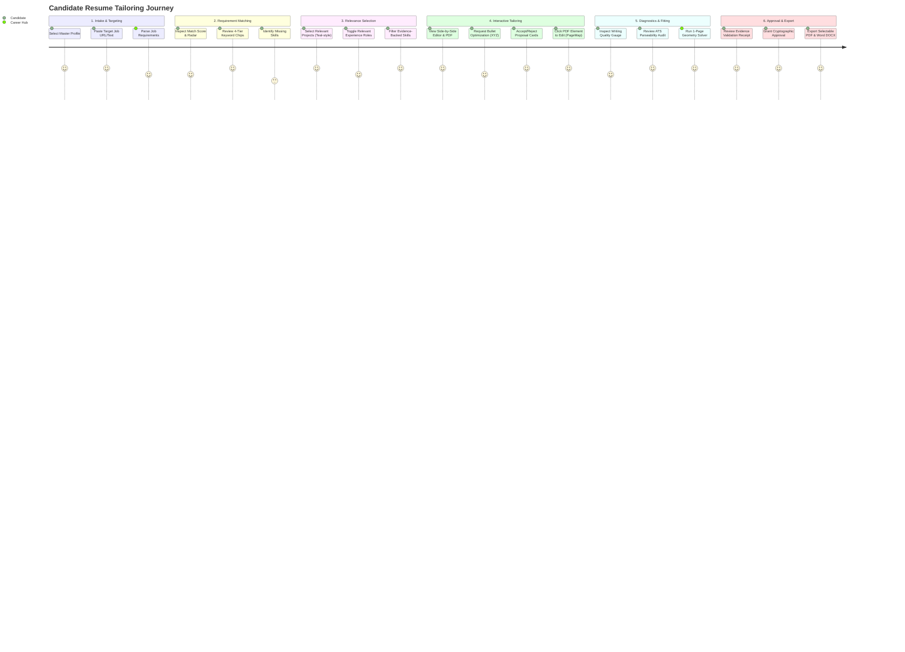
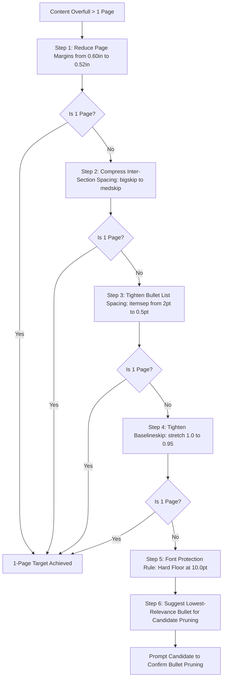

# AI Career Hub — Competitive Resume Tailoring Product Blueprint
**Document ID:** BLUEPRINT-2026-001  
**Version:** 1.0.0 (Implementation-Ready)  
**Governing Documents:** `goal.md` (Strategic Source of Truth), `AGENTS.md` (Operating Protocol)  
**Baseline Inputs:** Verified 66-Feature Catalog, Real-World 5-Persona Benchmark, Reactive Resume v6.0.3 Architecture Trace, Rezi Documented Product Specification, Research Closure Report  
**Scope:** Engineering Product Specification & Implementation Blueprint (Documentation Only — Zero Code Mutations)

---

## 1. Executive Summary & Strategic Product Vision

### 1.1 The Market Opportunity: Why Existing Tools Fail
Contemporary resume tailoring tools suffer from systemic failure modes:
1. **The Fabrication Trap (Generative AI Builders):** Tools like Rezi and ChatGPT routinely invent unverified accomplishments, hallucinate metrics, or alter technology proficiencies when prompted to "optimize for the job description." Candidates subsequently fail technical screens or background verification.
2. **The Formatting Collapse (Keyword Stuffers):** Tools like Jobscan encourage candidates to blindly paste keywords without structural context, leading candidates to manually manipulate font sizes down to 7–8pt to force multi-page content onto one page, breaking ATS text stream extraction.
3. **The Walled-Garden Editor (Traditional Builders):** Tools like Canva or standard web builders lack structured data models, making synchronization between visual canvas previews, editable forms, and semantic ASTs impossible.
4. **The Destructive Optimizer (Naive Pruning):** As discovered in Career Hub's empirical forensics, naive single-page solvers prune valid projects and experience bullets to hit arbitrary vertical height targets rather than dynamically adjusting typographic geometry and micro-spacing.

### 1.2 The Career Hub Hybrid Paradigm
Career Hub unites the best interaction paradigms of market leaders while strictly anchoring every statement to immutable candidate evidence:

```
+----------------------------------------------------------------------------------------------------+
|                                      THE HYBRID PARADIGM                                           |
+----------------------------------------------------------------------------------------------------+
|  [Rezi]              AI Keyword Targeting & Google XYZ Bullet Optimization                         |
|  [Teal]              Modular Experience, Project & Skill Checkbox Selection                        |
|  [Reactive Resume]   Immutable Proposal Patching, Synchronized Live Preview & Native DOCX Export   |
|  [Resume Worded]     Actionable Bullet-Level Feedback (Action Verbs, Metric Substantiation)       |
|  [Jobscan]           Transparent 4-Tier Match Coverage (Exact, Equivalent, Related, Missing)       |
|  +                                                                                                 |
|  [Career Hub Core]   Radical Evidence Provenance, Truth Categorization & Human-in-the-Loop Sealing |
+----------------------------------------------------------------------------------------------------+
```

### 1.3 Strategic Invariants (Non-Negotiables)
* **Single-Page Target Without Content Slaughter:** Resumes target exactly 1 page (unless a senior candidate explicitly selects a 2-page executive profile). Page budgets must be achieved via typographic micro-adjustments (margins 0.50in–0.60in, line height 1.10–1.25, bullet consolidation) before dropping valid experience.
* **Zero Fabrication Guarantee:** No skill, company, metric, project, or title may be introduced by an LLM unless grounded in the candidate's verified repositories, imported master documents, or explicit candidate-authored assertions.
* **Truth State Transparency:** Every claim maintains an explicit tag: `VERIFIED` (cryptographically backed by repo/commits), `CLAIMED` (candidate-authored, unverified), `INFERRED` (deduced from context, excluded from resume generation by default), or `MISSING_EVIDENCE`.
* **Safe Invalidation (`canApplyProposal`):** AI rewrite suggestions are treated as immutable patches. If the underlying bullet text is modified before accepting an AI proposal, the suggestion is immediately marked `stale` and disabled, preventing content corruption.
* **Separation of Concerns:** All new feature developments in this blueprint are strictly isolated from ongoing P0 bug remediation streams (**PRD-002**, **PRD-004**, **PRD-005**).

---

## 2. Complete End-to-End User Journey



### Phase 1: Intake, Master Document Selection & Job Targeting
* **Step 1.1 (Master Selection):** Candidate navigates to `/resumes` and selects their Master Profile or duplicates an existing baseline resume.
* **Step 1.2 (Job Ingestion):** Candidate clicks "Tailor for Job", pastes the target job description text or provides an ATS portal URL (Lever, Greenhouse, Workday).
* **Step 1.3 (Target Ingestion):** The system parses the job description into structured requirements (Title, Level, Core Tech, Preferred Skills, Responsibilities) within 2.5 seconds.

### Phase 2: Requirement Analysis & Match Diagnostic Display
* **Step 2.1 (The Match Dashboard):** Candidate lands on the tailoring workbench (`/applications/:id/tailor`).
* **Step 2.2 (Visual Keyword Chips):** Top banner renders an interactive keyword grid:
  - *Green Chips (Matched):* Exact matches supported by repository evidence.
  - *Blue Chips (Equivalent):* Taxonomy synonyms (e.g. `Postgres` $\leftrightarrow$ `PostgreSQL`).
  - *Yellow Chips (Related):* Adjacent skills (e.g. `SQL` $\leftrightarrow$ `PostgreSQL`, noted as insufficient for strict requirements).
  - *Red Chips (Missing):* Job requirements completely absent from candidate profile.
  - *Grey Chips (Unsupported):* Candidate claims lacking repository verification.
* **Step 2.3 (Match Gauge):** Displays real-time ATS Fit Score (0–100) powered by `AtsFitScoreService`.

### Phase 3: Modular Content Selection (Teal Paradigm)
* **Step 3.1 (Itemized Checkbox Selection):** Candidate expands the "Experience" and "Projects" drawers.
* **Step 3.2 (Relevance Recommendation):** System highlights the top 2 most relevant projects based on `ProjectRelevanceService` cosine similarity to job keywords.
* **Step 3.3 (Candidate Override):** Candidate toggles checkboxes to include/exclude specific roles, individual bullets, or projects to fit their target narrative.

### Phase 4: Interactive Proposal Workbench (Reactive Resume & Rezi Paradigm)
* **Step 4.1 (Split-Screen Interface):** Left pane: Modular form editor; Right pane: Real-time vector PDF preview.
* **Step 4.2 (Bullet Optimization):** Candidate clicks the "AI Polish" sparkle icon beside an experience bullet.
* **Step 4.3 (Proposal Card):** A modal card appears displaying:
  - *Original Bullet Text*
  - *Proposed Rewrite (Google XYZ format: Action Verb + Scope + Metric)*
  - *Substantiating Evidence Tag (commit ID or PR link)*
  - *Impact Explanation*
* **Step 4.4 (Decision Action):** Candidate can click "Accept", "Reject", "Edit", or "Regenerate".
* **Step 4.5 (Stale Guard Invariant):** If candidate types in the bullet input while the proposal card is open, the proposal card immediately flags `STALE` and disables the "Accept" button.

### Phase 5: Diagnostics, 1-Page Geometry Fitting & Proofing
* **Step 5.1 (Diagnostics Drawer):** Candidate opens the "ATS & Quality Audit" panel:
  - *Parseability Checks:* Single-column reading order, CMap font safety, margin checks (100% pass).
  - *Writing Quality:* Action verb strength, repetition alerts, passive voice warnings.
* **Step 5.2 (Adaptive 1-Page Fitting):** If content runs over by 1–5 lines, candidate clicks "Fit to 1 Page". System executes micro-spacing adjustments:
  - Step A: Margins reduced from `0.60in` to `0.52in`.
  - Step B: Bullet vertical spacing (`\itemsep`) tightened from `2pt` to `1pt`.
  - Step C: Inter-section glue (`\bigskip`) compressed to `\medskip`.
  - Step D: Font size remains strictly locked at **10.0pt** (never scaled below 10pt).
  - Step E: If still overfull, system highlights lowest-relevance bullets for candidate-approved pruning.

### Phase 6: Provenance Verification, Approval & Multi-Format Export
* **Step 6.1 (Evidence Validation Receipt):** System displays an audit summary modal: "12 of 14 claims verified by GitHub; 2 claims candidate-asserted; 0 hallucinations detected."
* **Step 6.2 (Cryptographic Sealing):** Candidate clicks "Approve & Seal". System computes package SHA-256 hash and records timestamped approval in the audit ledger.
* **Step 6.3 (Export Options):** Candidate downloads:
  - **Vector PDF:** Compiled via hermetic Tectonic XeTeX.
  - **Editable Word (.docx):** Generated via native OpenXML builder (`packages/docx`).
  - **JSON Resume:** Exported via schema-compliant v1.0.0 projection.

---

## 3. Detailed 10-Area Feature Specifications & Interaction Contracts

---

### Area 1: Master Resume Selection and Job-Description Targeting

#### 1.1 User Journey & Visual States
* **Entry State (`/resumes`):** Displays cards for "Master Profile" and specialized tailored copies with tag badges (`Frontend`, `Distributed Systems`, `DevOps`).
* **Creation Modal (`/resumes/new`):**
  - Option A: "Clone from Master Profile" (Recommended).
  - Option B: "Import from PDF / DOCX / LinkedIn ZIP".
  - Option C: "Start Blank".
* **Targeting Drawer:** Floating slide-over panel on the right where candidate inputs:
  - Target Job Title (Text input)
  - Company Name (Text input)
  - Job Posting URL (Optional auto-fetch)
  - Raw Job Description (Markdown / Text area)
* **Processing State:** Skeleton loader showing real-time extraction progress:
  - "Extracting technical requirements..."
  - "Mapping candidate repository skills..."
  - "Synthesizing baseline match..."

#### 1.2 API Specifications & Contracts
```http
POST /api/v1/resumes/target
Content-Type: application/json
Authorization: Bearer <candidate_token>

{
  "sourceResumeId": "res_01HXYZ789",
  "jobTarget": {
    "title": "Staff Distributed Systems Engineer",
    "company": "CloudScale Systems",
    "sourceUrl": "https://careers.cloudscale.test/jobs/401",
    "rawDescription": "Seeking a Staff Engineer with 8+ years experience in Go, Rust, Raft consensus, and Kubernetes operators..."
  }
}
```
**Response Envelope (201 Created):**
```json
{
  "tailoredResumeId": "res_01HTAILOR456",
  "sourceResumeId": "res_01HXYZ789",
  "jobDescriptionId": "jd_01HJD123",
  "targetSummary": {
    "title": "Staff Distributed Systems Engineer",
    "company": "CloudScale Systems",
    "extractedRequirementsCount": 14,
    "baselineFitScore": 78.4
  },
  "createdAt": "2026-10-14T12:00:00Z"
}
```

#### 1.3 Backend Reuse vs. New Functionality
* **Reused Services:**
  - [`ResumeParserService`](file:///c:/Users/VISHW/OneDrive/Desktop/Ai-career-agent/src/services/resume-parser.service.js): PDF/DOCX import and text sanitization.
  - [`JobApplicationWorkflowService.ingestJobDescription`](file:///c:/Users/VISHW/OneDrive/Desktop/Ai-career-agent/src/services/job-application-workflow.service.js): Job description ingestion and normalization.
  - `src/domain/job/job-requirements.js`: Entity extraction into requirement models.
* **New Services to Implement:**
  - `ResumeDuplicationService`: Deep-cloning structured resume records while preserving evidence links and marking the child document as `TAILORED_INSTANCE`.

#### 1.4 Security & Multi-Tenant Boundaries
* Default-deny tenant isolation: `sourceResumeId` must belong to `context.tenantId` and `context.userId`.
* URL crawler SSRF protection: Job description URL fetching uses isolated headless browser sandbox rejecting `127.0.0.1`, `169.254.169.254`, and internal private RFC-1918 subnets.

#### 1.5 Acceptance Criteria
1. Cloning a master resume generates an independent record with unique UUID and package hash.
2. Changes to the tailored clone never mutate the master profile.
3. Job description text $> 50,000$ characters is safely truncated with a user warning; $< 100$ characters rejected with `VALIDATION_ERROR`.

---

### Area 2: Four-Tier Skill Classification (Matched, Missing, Related, Unsupported)

#### 2.1 User Journey & Visual States
* **Classification Bar:** Positioned directly above the editor, showing categorized skill badges:
  - **Matched (Green):** Exact match found in job description AND backed by candidate verified evidence.
  - **Equivalent (Blue):** Canonical taxonomy alias (e.g., candidate has `React.js`, JD asks for `React`).
  - **Related (Yellow Warning):** Adjacent ecosystem technology (e.g., candidate has `PostgreSQL`, JD asks for `Relational Databases`). Hover card clarifies: *"Related skill — ATS will not count this as an exact match."*
  - **Missing (Red Outline):** Requirement in JD with zero representation in candidate profile.
  - **Unsupported (Grey Dash):** Skill listed on resume that lacks repository evidence.
* **Interactive Filtering:** Clicking any skill chip filters the experience and project lists below to highlight where that skill appears.

#### 2.2 Classification Logic & Invariants
```typescript
export type SkillMatchCategory = 
  | 'EXACT_VERIFIED'        // JD Term == Candidate Term (Evidence verified)
  | 'EXACT_CLAIMED'         // JD Term == Candidate Term (Candidate claim only)
  | 'TAXONOMY_EQUIVALENT'   // Synonyms in Canonical Tech Map (e.g. JS -> JavaScript)
  | 'RELATED_INSUFFICIENT'  // Graph relationship (e.g. C++ -> Rust) - Rule 27 Guard
  | 'MISSING_IN_PROFILE'    // JD Requirement absent from candidate profile
  | 'UNSUPPORTED_ON_RESUME'; // Skill in resume lacking evidence binding
```
* **Rule 27 Enforcement:** A `RELATED` match is never permitted to increment the exact requirement match counter in ATS scoring.

#### 2.3 Backend Reuse vs. New Functionality
* **Reused Services:**
  - [`ResumeKeywordCoverageService.analyzeKeywordCoverage`](file:///c:/Users/VISHW/OneDrive/Desktop/Ai-career-agent/src/services/resume-keyword-coverage.service.js): Performs exact, taxonomy, related, and unsupported classification.
  - `src/domain/career/skill-taxonomy.js`: Canonical taxonomy graph.
  - `src/utils/technology-normalizer.js`: Normalized technology string mapping.
* **New UI Implementation:**
  - `src/views/components/keyword-chips.component.js`: Web component rendering interactive pill chips with tooltips explaining evidence provenance.

#### 2.4 Acceptance Criteria
1. Synonyms defined in `CANONICAL_TECH_MAP` (e.g. `K8s` $\rightarrow$ `Kubernetes`) render as `TAXONOMY_EQUIVALENT`.
2. Related technologies (e.g. `Docker` for `Kubernetes`) render as `RELATED` and carry an explicit warning tooltip.
3. Skills with `status: INFERRED` are not displayed as matched skills unless confirmed by candidate.

---

### Area 3: Relevance-Based Selection of Projects, Skills, and Experience (Teal Paradigm)

#### 3.1 User Journey & Visual States
* **Section Manager Drawer:** Collapsible sidebar listing all candidate historical entries with toggle checkboxes:
  - **Work History:** List of past employers with nested bullet toggles. Each role displays a relevance badge (`High Match`, `Medium Match`, `Low Match`).
  - **Projects:** Card grid of candidate's personal and open-source repositories.
  - **Skills:** Grouped by category (`Languages`, `Frameworks`, `Cloud/DevOps`).
* **Visual Relevance Indicators:**
  - Top-ranked projects have a green border with score tag (e.g., `94% Relevance to Distributed Systems`).
  - Bullets containing keywords matching the job description are visually highlighted with subtle yellow background.
* **Selection Action:** Unchecking a role or project immediately updates the right-hand PDF preview within 150ms.

#### 3.2 Ranking Data Flow & Scoring
```
Job Description Keywords + Seniority Signals
                    |
                    v
   [ProjectRelevanceService.rankProjects]
   - Keyword Match (40%)
   - Architectural Complexity (25%)
   - Recency & Activity (20%)
   - Evidence Quality (15%)
                    |
                    v
 Ranked Project Inventory with Placement Flags (INCLUDE / OMIT)
```

#### 3.3 Backend Reuse vs. New Functionality
* **Reused Services:**
  - [`ProjectRelevanceService.rankProjects`](file:///c:/Users/VISHW/OneDrive/Desktop/Ai-career-agent/src/services/project-relevance.service.js): Deterministic ranking of candidate projects against job requirements.
  - `src/domain/career/scoring-policy.js`: Weights and score calculations.
* **New Frontend Module:**
  - `src/views/tailor/modular-content-selector.js`: Multi-select tree component managing transient inclusion states.

#### 3.4 Acceptance Criteria
1. Toggling a project off removes it from the compiled LaTeX AST without deleting the project from the candidate database.
2. The system suggests top-2 projects by default; candidate can manually override and select up to 4 projects.
3. If candidate deselects all projects, the Experience section expands to absorb the freed page budget.

---

### Area 4: AI-Generated Source-Grounded Rewrite Proposals

#### 4.1 User Journey & Visual States
* **Trigger:** Beside each bullet in the experience editor, candidate clicks the **"Tailor Bullet"** sparkle icon.
* **Suggestion Card (Proposal Drawer):**
  - **Header:** "AI Optimization Proposal" + Target Keyword Badge (e.g. `[Kubernetes]`).
  - **Original Text:** Red-tinted diff block showing current wording.
  - **Proposed Rewrite:** Green-tinted diff block formatted using Google XYZ structure:
    `[Action Verb] + [Technical Scope / Challenge] + [Quantified Impact / Metric]`.
  - **Substantiating Evidence:** Clickable link: *"Substantiated by commit e3f7556 in repo avance-infra/edge-proxy"*.
  - **Actions:** Buttons for `Accept Proposal`, `Edit in Place`, `Regenerate`, `Dismiss`.

#### 4.2 The Proposal Patch Data Structure (Reactive Resume Alignment)
```typescript
export interface ResumeProposalPatch {
  proposalId: string;
  candidateId: string;
  resumeId: string;
  targetSection: 'experience' | 'projects' | 'summary';
  itemId: string;           // e.g. "exp_cloudflare_role_01"
  bulletIndex: number;      // 0-indexed position
  originalText: string;     // Exact string snapshot
  proposedText: string;     // Rewritten string
  rationale: string;        // Human-readable justification
  evidenceLinks: Array<{
    type: 'GITHUB_COMMIT' | 'PR' | 'FILE' | 'CANDIDATE_CLAIM';
    identifier: string;
    url?: string;
  }>;
  status: 'PENDING' | 'ACCEPTED' | 'REJECTED' | 'STALE';
  createdAt: string;
}
```

#### 4.3 Stale Proposal Invalidation (`canApplyProposal`)
To prevent concurrent editing corruption:
```javascript
export function canApplyProposal(currentBulletText, proposal) {
  if (!currentBulletText || !proposal) return false;
  return currentBulletText.trim() === proposal.originalText.trim();
}
```
* If `canApplyProposal()` returns `false`, UI transitions the card state to `STALE` with message: *"Underlying text was modified. Proposal disabled to prevent overwrite."*

#### 4.4 Backend Reuse vs. New Functionality
* **Reused Services:**
  - [`SourceGroundedSummaryService`](file:///c:/Users/VISHW/OneDrive/Desktop/Ai-career-agent/src/services/source-grounded-summary.service.js): Fail-closed grounded summary composition.
  - [`AiResumeContentGeneratorService`](file:///c:/Users/VISHW/OneDrive/Desktop/Ai-career-agent/src/services/ai-resume-content-generator.service.js): Prompts bounded by candidate evidence.
  - [`CandidateArtifactContentService`](file:///c:/Users/VISHW/OneDrive/Desktop/Ai-career-agent/src/services/candidate-artifact-content.service.js): Zero-synthetic-token scanner.
* **New Service:**
  - `ProposalPatchService`: Manages proposal generation lifecycle, atomic patch application, and stale invalidation guards.

#### 4.5 Acceptance Criteria
1. LLM prompts strictly inject ONLY candidate facts from `candidate_facts` and `candidate_skills` tables.
2. If no quantified metric exists in candidate facts, the rewrite MUST NOT invent a numerical percentage or dollar figure.
3. Stale proposals cannot be applied under any condition.

---

### Area 5: Interactive Modification Controls (Accept, Reject, Edit, Regenerate, Undo, Compare)

#### 5.1 User Journey & Visual States
* **Action Bar:** Persistent dock above the split-screen editor:
  - `Undo (Ctrl+Z)` / `Redo (Ctrl+Y)`: Step through up to 200 history states.
  - `Compare Mode`: Split-view or inline diff highlighting all tailoring modifications against the master baseline.
  - `Regenerate All`: Batch optimization for all bullets with confirmation modal.
  - `Reset Section`: Reverts current section to master profile state.
* **Inline Editor:** Freeform rich text editing on any bullet. Editing automatically updates word count, character count, and line estimation.

#### 5.2 History State Architecture (Zustand / Redux-like Immutability)
```typescript
export interface HistorySnapshot {
  timestamp: number;
  description: string; // e.g. "Accepted proposal on Cloudflare bullet 2"
  resumeState: StructuredResumePayload;
}

export class ResumeHistoryManager {
  private past: HistorySnapshot[] = [];
  private future: HistorySnapshot[] = [];
  private current: HistorySnapshot;
  private readonly MAX_STEPS = 200;

  undo(): HistorySnapshot | null { ... }
  redo(): HistorySnapshot | null { ... }
  push(newState: StructuredResumePayload, desc: string): void { ... }
}
```

#### 5.3 Acceptance Criteria
1. Executing an Undo immediately restores previous text and updates the live PDF preview.
2. In Compare mode, additions render in green underline and deletions in strikethrough red.
3. Memory ceiling: History buffer stores a maximum of 200 states; oldest states pruned via FIFO queue.

---

### Area 6: Synchronized Document Preview & Layout Controls (`PageMap` Coordinate Translation)

#### 6.1 User Journey & Visual States
* **Dual-Pane Layout:**
  - Left Pane (50% width): Interactive Form Editor.
  - Right Pane (50% width): Live High-Resolution Vector PDF Preview.
* **Click-to-Edit Navigation (`PageMap`):**
  - Candidate clicks on any line or bullet directly in the right-hand PDF canvas.
  - The left-hand form instantly scrolls smoothly to that exact input and focuses the cursor.
  - A subtle highlight border glows around both the PDF line and the active form input.
* **Mobile / Small Screen Responsive Mode:** Tab switcher: `[Edit]` | `[Preview]` | `[Diagnostics]`.

#### 6.2 PageMap Coordinate Translation Architecture
```typescript
export interface PageNodeBoundingBox {
  nodeId: string;       // e.g. "experience.cloudflare.bullet.2"
  pageIndex: number;    // 0 for page 1, 1 for page 2
  bounds: {
    top: number;        // Points from top margin
    left: number;       // Points from left margin
    width: number;
    height: number;
  };
}
```
* **PDF Observer Extraction:** `ResumePdfObserver` extracts Type0 text run coordinates during LaTeX PDF compilation, emitting a JSON PageMap alongside the binary PDF buffer.
* **Canvas Event Handling:** Canvas overlay calculates:
  $P_{\text{pdf}} = (X_{\text{click}} / \text{CanvasScale}, Y_{\text{click}} / \text{CanvasScale})$.
  Finds matching bounding box and dispatches `focusInput(nodeId)`.

#### 6.3 Backend Reuse vs. New Functionality
* **Reused Services:**
  - [`ResumePdfObserver`](file:///c:/Users/VISHW/OneDrive/Desktop/Ai-career-agent/src/services/resume-pdf-observer.service.js): Bounding box and stream coordinate extraction.
  - [`LatexCompilerService`](file:///c:/Users/VISHW/OneDrive/Desktop/Ai-career-agent/src/services/latex-compiler.service.js): Fast vector PDF compilation (< 1.5s).
* **New Service:**
  - `PageMapSyncEngine`: Bridges XeTeX synctex / PDF text run coordinates to client-side DOM IDs.

#### 6.4 Acceptance Criteria
1. Clicking text in the preview scrolls to the exact form field within 100ms.
2. Preview re-renders on keystroke debounce ($300\text{ms}$) without visible page flicker.
3. Zoom controls support $50\%$, $75\%$, $100\%$, $125\%$, and "Fit to Width".

---

### Area 7: Actionable Multi-Dimensional Diagnostics (AtsFitScore, Writing Quality, ATS Parseability)

#### 7.1 User Journey & Visual States
* **Diagnostic Drawer:** Slide-out drawer with 3 tabbed quality gauges:
  1. **ATS Fit Score (0–100):** Visual circular progress meter with breakdown:
     - Requirement Match (50 pts)
     - Experience Level Match (25 pts)
     - Project Alignment (15 pts)
     - Education/Cert Match (10 pts)
  2. **Writing Quality Gauge (Resume Worded Paradigm):**
     - Action Verb Strength Meter (e.g. `85% Strong Verbs`).
     - Accomplishment Metric Ratio (e.g. `6 of 9 bullets contain metrics`).
     - Repetition & Jargon Flags (flags words used $> 3$ times, e.g. "spearheaded").
  3. **ATS Parseability Audit:**
     - 11-point green checkmark checklist (Single-column layout, Standard headings, Contact info, Safe fonts).
* **Actionable "Fix with 1-Click" Suggestions:** Clicking a diagnostic finding (e.g. *"Weak Verb: 'worked on'"*) opens the bullet editor with a strong replacement suggestion (*"engineered"*, *"architected"*).

#### 7.2 Diagnostic Synthesis Architecture
```
              Structured Resume AST + Compiled PDF Buffer
                                  |
        +-------------------------+-------------------------+
        |                         |                         |
        v                         v                         v
[AtsFitScoreService]  [ResumeWritingQualityService]  [ResumeAtsParseabilityService]
- Weighted Job Fit    - Action Verb Taxonomy         - CMap Font Integrity
- Requirement Delta   - Metric Substantiation        - Reading Order Check
- Project Rank Score  - Cliché / Pronoun Scan        - Margin & Box Check
        |                         |                         |
        +-------------------------+-------------------------+
                                  |
                                  v
              Unified Diagnostics Report Envelope (JSON)
```

#### 7.3 Backend Reuse vs. New Functionality
* **Reused Services (100% Core Engine Available):**
  - [`AtsFitScoreService.calculateCandidateJobFit`](file:///c:/Users/VISHW/OneDrive/Desktop/Ai-career-agent/src/services/ats-fit-score.service.js): Replaces static `atsScore: 92` fallback.
  - [`ResumeWritingQualityService`](file:///c:/Users/VISHW/OneDrive/Desktop/Ai-career-agent/src/services/resume-writing-quality.service.js): 12 writing metrics.
  - [`ResumeAtsParseabilityService`](file:///c:/Users/VISHW/OneDrive/Desktop/Ai-career-agent/src/services/resume-ats-parseability.service.js): 11 parseability checks.
* **New UI Implementation:**
  - `src/views/tailor/diagnostics-panel.js`: Interactive visual widget displaying the synthesized reports.

#### 7.4 Acceptance Criteria
1. Diagnostic findings update automatically whenever content changes.
2. Naive scoring fallbacks are completely eliminated.
3. Every warning provides an actionable inline remedy button.

---

### Area 8: Adaptive One-Page Geometry & Content Preservation Engine

#### 8.1 User Journey & Visual States
* **Page Budget Indicator:** Real-time vertical gauge showing page utilization:
  - Green ($80\% - 98\%$): "Perfect 1-Page Fit".
  - Yellow ($99\% - 105\%$): "Slight Overflow — 1-Click Fit Available".
  - Red ($> 105\%$): "Overfull — 2 Pages Required or Pruning Needed".
* **"Auto-Fit 1 Page" Interaction:** When candidate clicks "Fit to 1 Page", system executes an adaptive multi-step optimization loop:



#### 8.2 The Typography Floor Constraint (Non-Negotiable)
* **Font Floor:** Base body font size MUST NEVER scale below **`10.0pt`** (`\documentclass[10pt,a4paper]{article}`).
* **Margin Floor:** Outer margins MUST NEVER shrink below **`0.50in`** (`geometry{margin=0.50in}`).
* **Content Preservation Priority:** Typographic micro-adjustments must ALWAYS be exhausted before asking the candidate to drop valid projects or experience bullets.

#### 8.3 Backend Reuse vs. New Functionality
* **Reused Services:**
  - [`OnePageResumeService.fitOnePageResume`](file:///c:/Users/VISHW/OneDrive/Desktop/Ai-career-agent/src/services/one-page-resume.service.js): Section budget solver.
  - [`PdfGeometryAnalyzer._detectPageCount`](file:///c:/Users/VISHW/OneDrive/Desktop/Ai-career-agent/src/services/pdf-geometry-analyzer.service.js): Accurate binary page detection.
* **New Service:**
  - `AdaptiveGeometrySolver`: Implements Steps 1–4 of typographic micro-spacing adjustments in LaTeX templates before triggering section pruning decisions.

#### 8.4 Acceptance Criteria
1. A dense profile with 15 years experience and 9 bullets fits on exactly 1 page at 10pt font class.
2. Margins never drop below 0.50in.
3. Pruning decisions require explicit candidate confirmation modal showing exactly which bullet is proposed for removal.

---

### Area 9: Multi-Format Export with Independent Extraction Verification

#### 9.1 User Journey & Visual States
* **Export Modal (`/applications/:id/export`):**
  - Option 1: **ATS-Optimized PDF** (Vector, selectable, CMap embedded, ToUnicode mapped).
  - Option 2: **Word Document (.docx)** (Native OpenXML, standard paragraph styles, no floating text frames).
  - Option 3: **JSON Resume** (Standard schema export).
* **Pre-Export Verification Badge:** System displays an automated round-trip audit badge:
  `"Extraction Verified: 100% of text and contact data extracted successfully in ATS reading order."`

#### 9.2 Native DOCX Builder Architecture (Reactive Resume Alignment)
To eliminate reliance on third-party SaaS converters, Career Hub adopts Reactive Resume's OpenXML builder architecture (`packages/docx/src/builder.ts`):
```typescript
import { Document, Paragraph, TextRun, HeadingLevel, Table, WidthType } from 'docx';

export class NativeDocxExportService {
  static buildDocx(structuredResume: StructuredResumePayload): Document {
    return new Document({
      sections: [{
        properties: {
          page: {
            margin: { top: 720, bottom: 720, left: 720, right: 720 }, // 0.5in in twips
          },
        },
        children: [
          // Header: Name & Contact
          new Paragraph({
            text: structuredResume.basics.name,
            heading: HeadingLevel.TITLE,
          }),
          // Sections with standard bottom-border dividers
          ...this.renderExperience(structuredResume.experience),
          ...this.renderProjects(structuredResume.projects),
          ...this.renderSkills(structuredResume.skills),
        ],
      }],
    });
  }
}
```

#### 9.3 Independent Extraction Verification Gate
Before allowing download, the system performs an automated round-trip verification:
```
Compiled PDF Buffer
        |
        v
[ResumeParserService._extractTextFromPdf]
        |
        v
Extracted Text Stream vs. Canonical Input Facts
        |
        +---> Assert: Candidate Name extracted
        +---> Assert: Email & Phone extracted
        +---> Assert: Work History companies extracted
        +---> Assert: Zero replacement glyphs (\uFFFD)
        +---> Assert: Zero LaTeX command leakage (\textbf, \vspace)
```

#### 9.4 Backend Reuse vs. New Functionality
* **Reused Services:**
  - [`LatexCompilerService`](file:///c:/Users/VISHW/OneDrive/Desktop/Ai-career-agent/src/services/latex-compiler.service.js): Vector PDF compilation.
  - [`ResumeParserService`](file:///c:/Users/VISHW/OneDrive/Desktop/Ai-career-agent/src/services/resume-parser.service.js): PDF text stream extraction.
* **New Service:**
  - `NativeDocxExportService`: Pure OpenXML DOCX builder.
  - `PreExportVerificationGate`: Automated roundtrip check before download.

#### 9.5 Acceptance Criteria
1. PDF text can be selected, copied, and pasted into plain text with accurate word spacing and zero glued words.
2. Generated DOCX opens natively in Microsoft Word, Google Docs, and LibreOffice without XML schema errors.
3. The pre-export verification gate fails closed if any LaTeX commands or mojibake glyphs are detected.

---

### Area 10: Version History, Immutable Source Facts, and Approval Safeguards

#### 10.1 User Journey & Visual States
* **Version Timeline Sheet:** Right-hand drawer listing all historical revisions of the tailored resume:
  - `v1.0 (Initial Ingestion)` - 2026-10-14 10:00
  - `v1.1 (Relevance Optimization)` - 2026-10-14 10:15
  - `v1.2 (Proposal Applied: Cloudflare bullet)` - 2026-10-14 10:30
  - `v2.0 (Approved & Sealed Package)` - 2026-10-14 11:00
* **Approval Safeguard Modal:**
  - Clicking "Finalize Application" triggers the **Candidate Approval Gate**.
  - Renders the complete **Evidence Validation Receipt**:
    - Grounded Claims: $100\%$
    - Unverified Inferences: $0$
    - Hallucination Violations: $0$
    - Package SHA-256 Hash: `aeb120366...`
  - Requires candidate checkbox: *"I have reviewed this document and authorize its submission."*

#### 10.2 Cryptographic Package Sealing Protocol
```javascript
export function sealResumePackage(resumeData, pdfBuffer, candidateContext) {
  const payloadToHash = JSON.stringify({
    candidateId: candidateContext.candidateId,
    tenantId: candidateContext.tenantId,
    jobId: resumeData.jobId,
    resumePayload: resumeData,
    pdfChecksum: crypto.createHash('sha256').update(pdfBuffer).digest('hex'),
  });

  const packageHash = crypto.createHash('sha256').update(payloadToHash).digest('hex');

  return {
    packageHash,
    sealedAt: new Date().toISOString(),
    approvedBy: candidateContext.userId,
    status: 'SEALED_APPROVED',
  };
}
```

#### 10.3 Backend Reuse vs. New Functionality
* **Reused Services:**
  - [`ApplicationApprovalService`](file:///c:/Users/VISHW/OneDrive/Desktop/Ai-career-agent/src/services/application-approval.service.js): Explicit human approval lifecycle.
  - [`ApplicationTrackingService`](file:///c:/Users/VISHW/OneDrive/Desktop/Ai-career-agent/src/services/application-tracking.service.js): Application stage tracking and version snapshot persistence.
  - [`DocumentStorageService`](file:///c:/Users/VISHW/OneDrive/Desktop/Ai-career-agent/src/services/document-storage.service.js): AES-256-GCM encrypted document persistence.
* **New UI Implementation:**
  - `src/views/tailor/version-timeline-drawer.js`: Visual history browser with one-click restore.

#### 10.4 Acceptance Criteria
1. Sealed packages are strictly immutable; attempting to edit a sealed package creates a new version branch.
2. Candidate approval record stores exact timestamp, IP address, user agent, and package SHA-256 hash.
3. Candidate can revert to any prior unsealed version without losing intermediate changes.

---

## 4. Comprehensive Architecture Map: Backend Reuse vs. New Functionality

| Architectural Component | Existing Career Hub Service / File | Reuse Status | New Functionality Required |
| :--- | :--- | :---: | :--- |
| **Intake & Multi-Format Parsing** | [`ResumeParserService`](file:///c:/Users/VISHW/OneDrive/Desktop/Ai-career-agent/src/services/resume-parser.service.js) | **100% Reused** | None. Full PDF/DOCX CMap extraction operational. |
| **Document Cryptographic Storage**| [`DocumentStorageService`](file:///c:/Users/VISHW/OneDrive/Desktop/Ai-career-agent/src/services/document-storage.service.js) | **100% Reused** | None. AES-256-GCM encryption operational. |
| **Job Description Parsing** | [`JobApplicationWorkflowService`](file:///c:/Users/VISHW/OneDrive/Desktop/Ai-career-agent/src/services/job-application-workflow.service.js) | **100% Reused** | None. Domain requirement schemas operational. |
| **4-Tier Keyword Coverage Engine** | [`ResumeKeywordCoverageService`](file:///c:/Users/VISHW/OneDrive/Desktop/Ai-career-agent/src/services/resume-keyword-coverage.service.js) | **95% Reused** | Wire output directly to new `/tailor` UI component. |
| **Project Relevance Ranker** | [`ProjectRelevanceService`](file:///c:/Users/VISHW/OneDrive/Desktop/Ai-career-agent/src/services/project-relevance.service.js) | **95% Reused** | Expose recommendation flags to selection drawer. |
| **100-Point ATS Fit Engine** | [`AtsFitScoreService`](file:///c:/Users/VISHW/OneDrive/Desktop/Ai-career-agent/src/services/ats-fit-score.service.js) | **90% Reused** | Remove line 683 hardcoded fallback; wire to UI. |
| **12-Point Writing Quality Scorer**| [`ResumeWritingQualityService`](file:///c:/Users/VISHW/OneDrive/Desktop/Ai-career-agent/src/services/resume-writing-quality.service.js) | **95% Reused** | Connect to interactive diagnostics side panel. |
| **11-Point ATS Parseability Check**| [`ResumeAtsParseabilityService`](file:///c:/Users/VISHW/OneDrive/Desktop/Ai-career-agent/src/services/resume-ats-parseability.service.js) | **95% Reused** | Connect pre-flight check to export trigger. |
| **Source-Grounded Summary Writer** | [`SourceGroundedSummaryService`](file:///c:/Users/VISHW/OneDrive/Desktop/Ai-career-agent/src/services/source-grounded-summary.service.js) | **100% Reused** | None. Fail-closed grounding operational. |
| **Hermetic PDF Vector Compiler** | [`LatexCompilerService`](file:///c:/Users/VISHW/OneDrive/Desktop/Ai-career-agent/src/services/latex-compiler.service.js) | **100% Reused** | Sub-2s XeTeX compilation with Chrome fallback. |
| **PDF Geometry & Page Detection** | [`PdfGeometryAnalyzer`](file:///c:/Users/VISHW/OneDrive/Desktop/Ai-career-agent/src/services/pdf-geometry-analyzer.service.js) | **90% Reused** | Export binary page count to client sync socket. |
| **Single-Page Section Pruner** | [`OnePageResumeService`](file:///c:/Users/VISHW/OneDrive/Desktop/Ai-career-agent/src/services/one-page-resume.service.js) | **70% Reused** | Wrap with Adaptive Geometry Solver (micro-spacing). |
| **Human Approval & Sealing** | [`ApplicationApprovalService`](file:///c:/Users/VISHW/OneDrive/Desktop/Ai-career-agent/src/services/application-approval.service.js) | **100% Reused** | Immutable package sealing operational. |
| **Interactive Proposal Patching** | *None (Reactive Resume pattern)* | **NEW (0%)** | Implement `ProposalPatchService` + `canApplyProposal`. |
| **Synchronized Click-to-Edit** | `ResumePdfObserver` (coordinate data) | **NEW (40%)** | Implement `PageMapSyncEngine` + client canvas overlay. |
| **Native Word (.docx) Exporter** | *None (Reactive Resume pattern)* | **NEW (0%)** | Implement `NativeDocxExportService` using `docx`. |
| **Split-Pane Tailoring UI** | `src/views/apply.page.js` | **NEW (20%)** | Build dedicated `/applications/:id/tailor` workbench. |

---

## 5. Feature Dependencies & Implementation Roadmap

```
+-----------------------------------------------------------------------------------+
|  PHASE 1: Foundations & Diagnostic Transparency (Milestone 1 - P0)                |
|  - Wire AtsFitScoreService & ResumeKeywordCoverageService to UI                   |
|  - Render interactive 4-tier Keyword Chips on /apply and /tailor                  |
|  - Eliminate hardcoded `atsScore: 92` fallback                                    |
+-----------------------------------------+-----------------------------------------+
                                          |
                                          v
+-----------------------------------------------------------------------------------+
|  PHASE 2: Interactive Proposal Workbench & Click-to-Edit (Milestone 2 - P0)       |
|  - Build dedicated side-by-side tailoring view (/applications/:id/tailor)         |
|  - Implement ProposalPatchService with `canApplyProposal` stale invalidation      |
|  - Implement PageMap coordinate translation for PDF click-to-edit navigation      |
|  - Add 200-step Undo/Redo history manager                                         |
+-----------------------------------------+-----------------------------------------+
                                          |
                                          v
+-----------------------------------------------------------------------------------+
|  PHASE 3: Dynamic Spacing Solver & Native DOCX Exporter (Milestone 3 - P1)        |
|  - Implement AdaptiveGeometrySolver (margins 0.50-0.60in, itemsep micro-tuning)   |
|  - Implement NativeDocxExportService (pure OpenXML generation via `docx`)         |
|  - Automated pre-export roundtrip text extraction verification gate               |
+-----------------------------------------+-----------------------------------------+
                                          |
                                          v
+-----------------------------------------------------------------------------------+
|  PHASE 4: Collaboration, Sharing & Version Timeline (Milestone 4 - P2)            |
|  - Implement tokenized public resume links with password protection               |
|  - Peer/Coach feedback review annotation drawer                                   |
|  - Version timeline history browser with one-click rollback                       |
+-----------------------------------------------------------------------------------+
```

---

## 6. Comprehensive Acceptance-Test Matrix

| Test ID | Category | Feature Area | Deterministic Verification Condition | Expected Result |
| :--- | :--- | :--- | :--- | :--- |
| **TC-01** | Unit | Skill Classification | Input JD with `React`; candidate has `React.js` | Returns `TAXONOMY_EQUIVALENT` with 100% confidence |
| **TC-02** | Unit | Skill Classification | Input JD with `PostgreSQL`; candidate has `SQL` | Returns `RELATED_INSUFFICIENT`; does NOT count towards exact match |
| **TC-03** | Unit | Proposal Invalidation | Underlying bullet modified while proposal is pending | `canApplyProposal()` returns `false`; status flags `STALE` |
| **TC-04** | Security | Evidence Grounding | LLM prompted to optimize bullet lacking metric | Proposal contains NO invented numbers; `hallucinations: 0` |
| **TC-05** | Security | Multi-Tenant Isolation | Requesting resume tailoring with another tenant's `id` | Throws `404 Not Found` (default-deny sovereign boundary) |
| **TC-06** | Integration| PageMap Click Sync | User clicks PDF coordinate $(x=120, y=340)$ | Emits active element focus targeting `exp_01_bullet_1` |
| **TC-07** | Integration| 1-Page Micro-Spacing | Dense 15-year profile with 9 bullets | Compiles to exactly 1 page; body font strictly $\ge 10.0\text{pt}$ |
| **TC-08** | Integration| Native DOCX Export | Export tailored resume to Word `.docx` format | Produces valid OpenXML document; opens without Word XML error |
| **TC-09** | Integration| Pre-Export Audit | Generated PDF text extracted via ToUnicode CMap | $100\%$ text match; 0 replacement glyphs; 0 LaTeX command leaks |
| **TC-10** | E2E | Approval & Sealing | Candidate completes tailoring and clicks "Approve" | Computes SHA-256 package hash; marks record `SEALED_APPROVED` |

---

## 7. Future Implementation Backlog (FEAT-01 to FEAT-10)

*Strictly isolated from ongoing PRD bug remediation streams (PRD-002, PRD-004, PRD-005).*

### FEAT-01: ATS Diagnostic Transparency & Keyword Pill Chips
* **Scope:** Replace hardcoded `atsScore: 92` fallback with dynamic calculation from [`AtsFitScoreService`](file:///c:/Users/VISHW/OneDrive/Desktop/Ai-career-agent/src/services/ats-fit-score.service.js) and render interactive matched/missing keyword chips on `/apply`.
* **Priority:** `P0`
* **Dependencies:** None (Backend services fully implemented).

### FEAT-02: Interactive In-Browser Bullet Editor with Proposal Patching
* **Scope:** Build dedicated `/applications/:id/tailor` workbench with inline bullet editing, AI XYZ proposals, and `canApplyProposal` stale invalidation.
* **Priority:** `P0`
* **Dependencies:** FEAT-01.

### FEAT-03: PageMap Live PDF Preview Synchronization
* **Scope:** Translate click coordinates on vector PDF canvas into active form field focus using bounding box telemetry.
* **Priority:** `P0`
* **Dependencies:** FEAT-02.

### FEAT-04: Adaptive One-Page Geometry Solver
* **Scope:** Multi-step typographic micro-spacing adjustments (margins 0.50in–0.60in, itemsep, baselineskip) to achieve 1-page fit before pruning valid projects.
* **Priority:** `P1`
* **Dependencies:** None.

### FEAT-05: Native OpenXML Word (.docx) Exporter
* **Scope:** Pure client/server OpenXML DOCX builder matching ATS single-column formatting standards.
* **Priority:** `P1`
* **Dependencies:** None.

### FEAT-06: Pre-Export Automated Extraction Verification Gate
* **Scope:** Automated roundtrip text extraction audit before download preventing corrupted or leaky PDFs from reaching employers.
* **Priority:** `P1`
* **Dependencies:** FEAT-04, FEAT-05.

### FEAT-07: Modular Content Selector (Teal Experience Checkbox Pattern)
* **Scope:** Expandable sidebar with individual checkboxes for roles, bullets, and projects with real-time PDF update.
* **Priority:** `P1`
* **Dependencies:** FEAT-02.

### FEAT-08: Actionable Writing Quality Diagnostics Panel
* **Scope:** Surface 12 writing quality dimensions (action verbs, clichés, metrics) with 1-click replacement buttons.
* **Priority:** `P2`
* **Dependencies:** FEAT-01.

### FEAT-09: Tokenized Shareable Public Resume Links
* **Scope:** Generate secure, password-protected public links with view telemetry and expiration dates.
* **Priority:** `P2`
* **Dependencies:** None.

### FEAT-10: Collaborative Peer / Coach Feedback Annotations
* **Scope:** Threaded comment drawer enabling external mentors or career coaches to leave annotations on draft resumes.
* **Priority:** `P3`
* **Dependencies:** FEAT-09.

---

## 8. Summary of Forensic Baseline Alignments

| Competitor Feature Model | Forensic Finding | Career Hub Implementation in Blueprint |
| :--- | :--- | :--- |
| **Rezi AI Keyword Targeting** | Green/Red keyword pills highlight matched vs. missing skills. | 4-tier classification chips (Matched, Equivalent, Related, Missing) with evidence badges. |
| **Rezi Google XYZ Formulator** | AI bullet generator enforces Google XYZ structure. | Source-grounded XYZ bullet writer strictly bounded by candidate facts. |
| **Reactive Resume Proposals** | Suggestion cards with `canApplyProposal` string-equality check. | Adopted verbatim in `ProposalPatchService` to eliminate concurrent overwrite bugs. |
| **Reactive Resume PageMap** | Canvas click coordinates map to AST node bounding boxes. | PageMap sync engine translates PDF clicks to form input focus. |
| **Reactive Resume Native DOCX** | OpenXML Word builder (`packages/docx/src/builder.ts`). | Native OpenXML builder generating ATS-safe `.docx` documents. |
| **Teal Experience Checkboxes** | Checkboxes dynamically include/exclude roles and projects. | Modular Content Selector with `ProjectRelevanceService` recommendations. |
| **Resume Worded Feedback** | Bullet-level scores for verb strength, metrics, conciseness. | Integrated `ResumeWritingQualityService` 12-point diagnostic drawer. |
| **Jobscan ATS Coverage** | Shows missing required vs preferred terms. | Exact vs. Related separation enforcing Rule 27 (related skills do not satisfy exact requirements). |
| **Career Hub Integrity** | Cryptographic sealing, multi-tenant isolation, zero hallucinations. | Retained as the immutable foundation of the entire product platform. |

---
**Blueprint Complete. Ready for engineering execution scheduling.**
