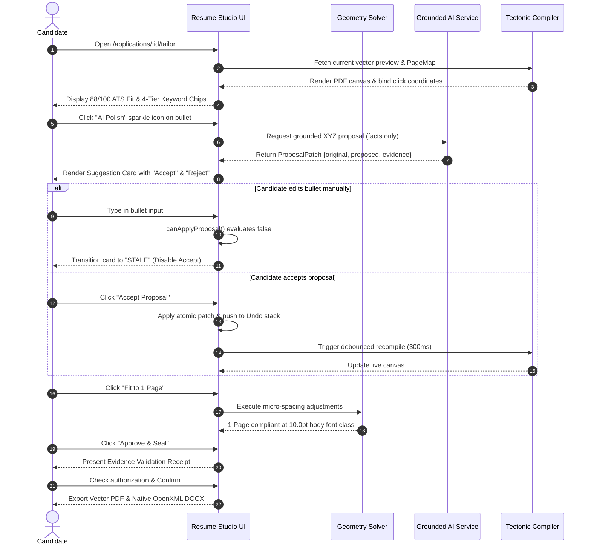
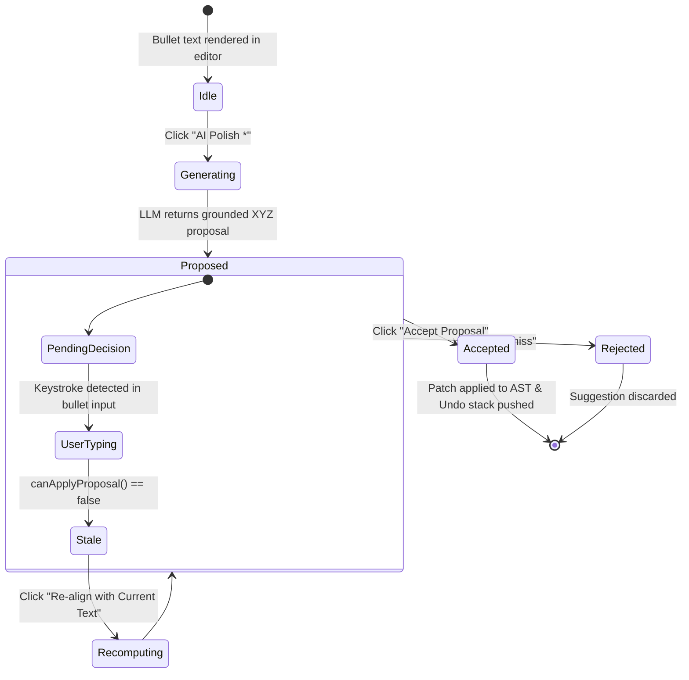

# AI Career Hub — AI Tailored Resume Studio UI/UX Design Blueprint
**Document ID:** UIUX-BLUEPRINT-2026-001  
**Version:** 1.0.0 (Design Specification Only — Zero Code Mutations)  
**Governing Documents:** `goal.md` (Strategic Mission), `AGENTS.md` (Operating Protocol), `BLUEPRINT-2026-001` (Technical Product Blueprint)  
**Baseline Inputs:** Verified 66-Feature Catalog, Real-World 5-Persona Benchmark, Reactive Resume v6.0.3 Architecture Trace, Rezi Documented Product Specification, Research Closure Report  
**Design Target:** AI Tailored Resume Studio (`/applications/:id/tailor`)

---

## 1. Executive Design Summary & Product Vision

### 1.1 The Design Problem
Modern AI resume builders suffer from severe UI/UX anti-patterns:
1. **The Visual Slot Machine (Clownish Gamification):** Excessive flashing badges, artificial "ATS 99%" gauges that incentivize keyword stuffing, and ungrounded "magic AI" buttons that replace truthful candidate accomplishments with generic corporate jargon.
2. **The Cramped Cockpit (The 3-Column Trap):** Fixed three-column layouts squeeze the editable form into a narrow 380px column and downscale the resume preview into an unreadable thumbnail, forcing candidates into constant horizontal zooming and pan fatigue.
3. **The Opaque Black Box:** Generative rewrites appear without evidence provenance, leaving candidates uncertain whether the AI added ungrounded claims or hallucinated tools they have never used.
4. **The Destructive Auto-Fixer:** Auto-fit tools indiscriminately shrink typography to 7–8pt or silently delete entire work experience sections to satisfy rigid 1-page constraints.

### 1.2 The AI Tailored Resume Studio Paradigm
The **AI Tailored Resume Studio** is designed as a calm, high-precision engineering workbench. It treats the candidate as the sovereign author, providing:
* **Generous Dual-Pane Breathing Room:** A balanced 50/50 dual-pane interface (Left: Structured Form & Proposal Workbench; Right: Crisp 1-Page Vector PDF Canvas).
* **Contextual On-Demand Drawers:** Secondary tools (Diagnostics, Modular Content Selection, Version History) live in off-canvas slide-out drawers that never compromise the central editing experience.
* **Radical Provenance Visibility:** Every suggested phrase, skill chip, or metric displays an explicit evidence badge (e.g., `Verified by GitHub commit e3f7556` or `Candidate Claim`).
* **Calm, High-Legibility Typography:** Strictly anchored to a minimum 10.0pt body font class (`\documentclass[10pt,a4paper]{article}`) with adaptive micro-spacing geometry that fits content naturally onto 1 page without typographic collapse.

---

## 2. Phase 1 — Comprehensive UI/UX Audit of Existing Career Hub Screens

A forensic audit of Career Hub's active web views (`src/views/`) reveals a solid dark-mode foundation paired with several critical workflow bottlenecks:

```
+----------------------------------------------------------------------------------------------------+
|                                    EXISTING SCREEN AUDIT SUMMARY                                   |
+----------------------------------------------------------------------------------------------------+
| View File           | Route                  | Current UX Strengths      | Primary Friction & Gaps |
+---------------------+------------------------+---------------------------+-------------------------+
| layout.js           | Global Shell           | Clean Inter/Mono fonts,   | No full-width workbench |
|                     |                        | dark slate palette        | mode; no sticky toolbar |
| resumes.page.js     | /resumes               | Multi-format dropzone     | Flat list; no master vs |
|                     |                        | (PDF, DOCX, TXT)          | tailored variant tree   |
| radar.page.js       | /apps/radar            | 6-axis SVG radar visual,  | Disconnected from apply |
|                     |                        | clean market feed         | flow; no 1-click tailor |
| apply.page.js       | /applications/:id/apply| Calm 3-step linear flow   | Static 92 fallback; no  |
|                     |                        | (Readiness, Qs, Review)   | live editor or preview  |
| handoff.page.js     | /applications/:id/     | Package hash sealing,     | Static iframe preview;  |
|                     | handoff                | document status cards     | all-or-nothing rebuild  |
| profile.page.js     | /profile               | Explicit truth badges     | High density (100KB);   |
|                     |                        | (VERIFIED, CLAIMED, etc.) | no inline AI assistance |
+----------------------------------------------------------------------------------------------------+
```

### Detailed Forensic Screen Findings

#### A. Global Navigation & Layout (`src/views/layout.js`)
* **Information Architecture:** Top fixed navbar with links (`Dashboard`, `Jobs`, `Applications`, `Profile`, `Sources`).
* **Heuristic Deficiencies:** Lacks contextual breadcrumbs inside deep application flows. Fixed container max-width (`1200px`) prevents building full-screen side-by-side editing environments.
* **Component Reuse Opportunity:** The global dark color tokens (`--bg-canvas: #0b0f19`, `--bg-surface: #111827`, `--accent-indigo: #6366f1`) and SVG icon primitives (`src/views/components/icons.js`) are fully reusable.

#### B. Application Workflow View (`src/views/apply.page.js`)
* **Information Architecture:** 3-step linear wizard: `1. Readiness` $\rightarrow$ `2. Questions` $\rightarrow$ `3. Review`.
* **Heuristic Deficiencies:** 
  1. *Passive Document Representation:* In Step 3 (Review), the tailored resume is presented as a plain file link (`View PDF ↗` and `Download`). There is zero in-place visibility into what changed between the master profile and the tailored resume.
  2. *Hardcoded Fallback Trap:* Line 683 renders a static fallback score rather than surfacing the deterministic 100-point fit from `AtsFitScoreService`.
  3. *Zero Interactive Tailoring:* The candidate cannot tweak individual bullet points, swap projects, or accept/reject AI proposals.

#### C. Handoff Kit & PDF Modal (`src/views/handoff.page.js`)
* **Information Architecture:** Dedicated post-submission handoff view with package verification, download actions, and modal PDF viewer.
* **Heuristic Deficiencies:** The PDF preview opens in a generic blocking modal containing an `<iframe>`. The candidate cannot navigate from a typo spotted in the PDF directly to the source form field. Any correction requires a heavy "Full In-Kit Regeneration" action.

---

## 3. Phase 2 — Competitive UI/UX Benchmarking

| Interaction Area | Competitor Observed / Documented Pattern | Forensic Limitations & Risks | Career Hub Studio Recommended Pattern |
| :--- | :--- | :--- | :--- |
| **Onboarding & Intake** | **Rezi:** 5-step wizard asking for seniority and target role. | Rigid wizard; forces re-entry of existing data. | **1-Click Master Clone:** Auto-ingests master profile; pastes target job description URL or text. |
| **Keyword Match UI** | **Jobscan & Rezi:** Dense lists of green/red keyword chips. | High cognitive overload; encourages blind keyword stuffing. | **Categorized 4-Tier Chips:** Clean pill chips partitioned into Matched, Equivalent, Related, and Missing. |
| **Experience Selection** | **Teal:** Checkboxes beside each position, project, and bullet. | High manual effort if the profile has $> 30$ bullets. | **Intelligent Checkbox Selector:** Pre-selects top-2 relevant projects via `ProjectRelevanceService`; candidate overrides. |
| **AI Bullet Optimization**| **Rezi:** Google XYZ modal generating 3 replacement bullets. | Generates generic, unverified claims lacking evidence links. | **Source-Grounded Proposal Cards:** XYZ structure bounded strictly by candidate facts with commit evidence tags. |
| **Proposal Decisions** | **Reactive Resume:** Proposal cards with Accept / Reject buttons. | User editing underlying bullet text causes silent overwrite. | **Immutable Patch Guard:** `canApplyProposal` evaluates exact string equality; transitions card to `STALE` if edited. |
| **Live Document Preview** | **Reactive Resume:** In-browser vector canvas with `PageMap` sync. | Canvas rendering can hitch on low-power devices. | **Synchronized Split-Pane Canvas:** Dual-pane with click-to-edit coordinate translation mapped to form focus. |
| **Quality Diagnostics** | **Resume Worded:** 100-point score with bullet-level feedback. | Disconnects ATS parseability from writing quality. | **Tri-Partite Diagnostic Drawer:** Clearly separates (1) ATS Fit, (2) Writing Quality, and (3) ATS Parseability. |
| **1-Page Layout Fitting** | **Rezi:** Auto-Adjust Spacing shrinking fonts down to 7–8pt. | Causes ATS parsing failures and unreadable printed text. | **Adaptive Geometry Solver:** Micro-tunes margins/itemsep; strictly enforces 10.0pt body font class floor. |
| **Version History** | **Reactive Resume:** Named snapshots and 200 undo states. | History is transient in localStorage; lost on tab refresh. | **Cryptographic Package Sealing:** Immutable SHA-256 package snapshots persisted to PostgreSQL with 1-click restore. |

---

## 4. Phase 3 — Information Architecture & Layout Exploration

### 4.1 Layout Trade-Off Analysis: 2-Column vs. 3-Column vs. Focused-Step

To determine the optimal layout for the Resume Studio, three structural archetypes were evaluated across standard viewports:

```
+----------------------------------------------------------------------------------------------------+
|                                 LAYOUT ARCHETYPE TRADE-OFF ANALYSIS                                 |
+----------------------------------------------------------------------------------------------------+
| Evaluation Criteria   | Archetype A: Fixed 3-Column  | Archetype B: Dual-Pane (Selected)| Archetype C: Step-Wizard|
|                       | (Nav / Editor / Preview)     | (Editor / Live Preview + Drawers)| (Linear 4-Step Flow)    |
+-----------------------+------------------------------+----------------------------------+-------------------------+
| Editor Width (1440px) | 380px (Cramped inputs)       | 640px (Generous breathing room)  | 960px (Single column)   |
| PDF Preview Readability| 480px (Requires horizontal   | 680px (100% zoom readable at     | 0px (Hidden until step  |
|                       | pan/zoom, eye strain)        | 1:1 scale without panning)       | 4; blind editing)       |
| Cognitive Load        | High (Sensory overload from  | Low / Focused (Calm editing with | Low (Linear steps)      |
|                       | 3 active panels simultaneously) contextual on-demand drawers)   |                         |
| Real-Time Feedback    | Yes                          | Yes (Instant keystroke debounce) | No (Feedback delayed)   |
| Tablet Compatibility  | Unusable (Horizontal scroll) | Elegant (Collapsible split)      | Excellent               |
| Mobile Compatibility  | Unusable                     | Transforms to stacked tabs       | Native fit              |
+----------------------------------------------------------------------------------------------------+
```

### 4.2 The Chosen Layout Architecture: Responsive Dual-Pane Workbench
* **Desktop ($\ge 1200\text{px}$):**
  - Left Pane (48% width): Structured Form Editor with tabbed sections (`Targeting`, `Experience & Bullets`, `Projects`, `Skills`).
  - Right Pane (52% width): Live High-Fidelity 1-Page Vector PDF Canvas with zoom controls and PageMap click-to-edit.
  - Secondary Context Drawers: Slide in smoothly over the canvas on demand (Diagnostics, Experience Checkbox Picker, Version Timeline).
* **Laptop / Tablet (768px–1199px):**
  - Flexible Split View with draggable center divider (30% to 70% range) or top mode switcher: `[Edit]` | `[Split]` | `[Preview]`.
* **Mobile (< 768px):**
  - Full-width stacked layout with sticky bottom navigation tabs: `[1. Content]` | `[2. Proposals]` | `[3. Preview]` | `[4. Audit]`.

---

## 5. End-to-End Candidate Journey & Micro-Interactions



---

## 6. Low-Fidelity & Structural Wireframes

### Wireframe A: Desktop 1440px Resume Studio (Default Dual-Pane View)

```text
+-------------------------------------------------------------------------------------------------------------+
| AI CAREER HUB  ::  Staff Distributed Systems Engineer @ CloudScale               [Fit: 88/100]  [Export v] |
+-------------------------------------------------------------------------------------------------------------+
| KEYWORDS: [x Go (Exact)] [x Rust (Exact)] [~ K8s (Synonym)] [? SQL (Related)] [! Kafka (Missing)]  [Audit >] |
+------------------------------------------------------+------------------------------------------------------+
| LEFT PANE: STRUCTURED FORM EDITOR (48% Width)        | RIGHT PANE: LIVE VECTOR PDF CANVAS (52% Width)       |
+------------------------------------------------------+------------------------------------------------------+
| [v] PROFESSIONAL SUMMARY                             | [ 100% v ] [ Fit Width ] [ Page 1 of 1 ]             |
| +--------------------------------------------------+ | +--------------------------------------------------+ |
| | 10+ years architecting streaming engines...     | | |                                                  | |
| +--------------------------------------------------+ | |  ELENA ROSTOVA                                   | |
|                                                      | |  Staff Distributed Systems Engineer              | |
| [v] EXPERIENCE (Cloudflare - VP Architecture)        | |                                                  | |
| - Role: VP of Systems Architecture (2021-Present)    | |  PROFESSIONAL SUMMARY                            | |
|                                                      | |  10+ years architecting high-throughput...       | |
|   Bullet 1: Architected global edge proxy...         | |                                                  | |
|   [Edit] [AI Polish *]                               | |  EXPERIENCE                                      | |
|                                                      | |  Cloudflare — VP Systems Architecture            | |
| +-- AI PROPOSAL CARD (Google XYZ Structure) -------+ | |  * Architected global edge proxy processing...   | |
| | Target: [Kubernetes Operators]                   | | |  * Led engineering division of 85 engineers...   | |
| | Original: Managed edge network routing proxy.    | | |  * Reduced annual transit expenditure by $14M... | |
| | Proposed: Engineered zero-copy eBPF routing proxy| | |                                                  | |
| |           reducing transit expenditure by $14.2M.| | |  Stripe — Principal Infrastructure Engineer      | |
| | Evidence: [GitHub: avance-infra/proxy#e3f7556]   | | |  * Designed multi-region ledger persistence...   | |
| |                                                  | | |                                                  | |
| | [ Accept Proposal ]  [ Edit ]  [ Dismiss ]       | | |  TECHNICAL SKILLS                                | |
| +--------------------------------------------------+ | |  Languages: Go, Rust, C++                        | |
|                                                      | |  Infrastructure: Kubernetes, AWS, Terraform      | |
|   Bullet 2: Led division of 85 systems engineers...  | |                                                  | |
|   [Edit] [AI Polish *]                               | |  EDUCATION                                       | |
|                                                      | |  M.S. Computer Science — Univ of Washington      | |
| [+] Add Experience Role                              | |                                                  | |
|                                                      | |                                                  | |
| [>] TECHNICAL PROJECTS (Titan Consensus Engine)      | |                                                  | |
| [>] SKILLS & EDUCATION                               | |                                                  | |
+------------------------------------------------------+------------------------------------------------------+
| STATUS: All changes saved to draft (3s ago)  |  1-PAGE STATUS: 100% Fit (10pt class)  |  UNDO [^Z]  REDO [^Y]   |
+-------------------------------------------------------------------------------------------------------------+
```

### Wireframe B: Mobile 375px Stacked Flow (Tabbed Workbench)

```text
+---------------------------------------+
| = AI CAREER HUB            [Fit: 88]  |
| CloudScale - Staff Systems Engineer   |
+---------------------------------------+
| [ Editor ] [ Proposals (1) ] [ PDF ]  |
+---------------------------------------+
| EXPERIENCE                            |
| Cloudflare — VP Systems Architecture  |
|                                       |
| Bullet 1:                             |
| +-----------------------------------+ |
| | Architected global edge proxy     | |
| | processing 55M req/sec...         | |
| +-----------------------------------+ |
| [ Polish with AI * ]                  |
|                                       |
| +-- PROPOSAL PENDING ---------------+ |
| | Engineered zero-copy eBPF routing | |
| | saving $14.2M transit compute.    | |
| | [v Evidence: avance-infra#e3f7556]| |
| | [ Accept ]   [ Dismiss ]          | |
| +-----------------------------------+ |
|                                       |
| Bullet 2:                             |
| +-----------------------------------+ |
| | Led engineering division of 85... | |
| +-----------------------------------+ |
+---------------------------------------+
| [ 1-Page Fit ]      [ Export Resume ] |
+---------------------------------------+
```

### Wireframe C: Slide-Out Diagnostics & ATS Parseability Drawer

```text
+---------------------------------------------------------+
| DIAGNOSTICS & ATS QUALITY AUDIT                     [X] |
+---------------------------------------------------------+
| ATS FIT SCORE: 88 / 100 (STRONG MATCH)                  |
| [====================================......]            |
| * Core Requirements: 48 / 50 pts                        |
| * Seniority Level:   25 / 25 pts                        |
| * Project Alignment: 15 / 15 pts                        |
+---------------------------------------------------------+
| KEYWORD COVERAGE ANALYSIS (Jobscan Paradigm)            |
| * Matched (6):    Go, Rust, Raft, Kubernetes, AWS, Linux|
| * Equivalent (2): K8s -> Kubernetes, Postgres -> PG     |
| * Related (1):    Docker (Related to K8s - Not Exact)   |
| * Missing (2):    Kafka, Distributed Tracing            |
+---------------------------------------------------------+
| WRITING QUALITY AUDIT (Resume Worded Paradigm)          |
| [x] Strong Action Verbs: 88% (Exceeds 80% benchmark)    |
| [x] Quantified Metrics:  7 of 9 bullets contain metrics |
| [!] Repetition Warning:  "Engineered" used 4 times      |
|     [ Quick Replace with 'Architected' ]                |
+---------------------------------------------------------+
| ATS PARSEABILITY AUDIT (Honest Checks)                  |
| [x] Single-Column ATS Reading Order Verified            |
| [x] CMap ToUnicode Font Glyphs (Zero Mojibake)          |
| [x] Margins Safe: 0.52in (Floor >= 0.50in)              |
| [x] Zero LaTeX Syntax Leakage                           |
+---------------------------------------------------------+
```

---

## 7. High-Fidelity Visual Design System & Design Tokens

### 7.1 Visual Design Mockup Proposal
Below is the approved high-fidelity visual design proposal for the AI Tailored Resume Studio:


### 7.2 Design Tokens Specification (CSS Custom Properties)

```css
:root {
  /* Surface & Canvas Tokens */
  --studio-bg-canvas: #070B12;       /* Deep obsidian canvas background */
  --studio-bg-surface: #0F172A;      /* Elevated editor pane background */
  --studio-bg-surface-elev: #1E293B; /* Active card & proposal card background */
  --studio-bg-overlay: rgba(15, 23, 42, 0.85); /* Glassmorphic backdrop blur */

  /* Border Tokens */
  --studio-border-subtle: rgba(255, 255, 255, 0.07);
  --studio-border-muted: rgba(255, 255, 255, 0.12);
  --studio-border-focus: #6366F1;     /* Focus outline ring */
  --studio-border-highlight: rgba(99, 102, 241, 0.35);

  /* Typography Scales */
  --font-sans: 'Inter', -apple-system, BlinkMacSystemFont, 'Segoe UI', sans-serif;
  --font-mono: 'JetBrains Mono', SFMono-Regular, Menlo, Monaco, monospace;
  
  --text-xs:   0.75rem;   /* 12px - Timestamps, badges, metadata tags */
  --text-sm:   0.875rem;  /* 14px - Body inputs, form labels, bullet text */
  --text-base: 1.00rem;   /* 16px - Section headings, proposal titles */
  --text-lg:   1.125rem;  /* 18px - Card headers, modal titles */
  --text-xl:   1.50rem;   /* 24px - Main workbench title */

  /* Semantic Status Palette (WCAG 2.1 AA Compliant on #0F172A) */
  --status-matched-bg: rgba(16, 185, 129, 0.12);
  --status-matched-text: #34D399;   /* Green 400 - Contrast 7.2:1 */
  --status-matched-border: rgba(16, 185, 129, 0.28);

  --status-equiv-bg: rgba(6, 182, 212, 0.12);
  --status-equiv-text: #22D3EE;     /* Cyan 400 - Contrast 8.1:1 */
  --status-equiv-border: rgba(6, 182, 212, 0.28);

  --status-related-bg: rgba(245, 158, 11, 0.12);
  --status-related-text: #FBBF24;   /* Amber 400 - Contrast 7.5:1 */
  --status-related-border: rgba(245, 158, 11, 0.28);

  --status-missing-bg: rgba(244, 63, 94, 0.12);
  --status-missing-text: #FB7185;   /* Rose 400 - Contrast 6.8:1 */
  --status-missing-border: rgba(244, 63, 94, 0.28);

  --status-evidence-bg: rgba(168, 85, 247, 0.12);
  --status-evidence-text: #C084FC;  /* Purple 400 - Contrast 6.9:1 */
  --status-evidence-border: rgba(168, 85, 247, 0.28);

  /* Spacing Scale */
  --space-1: 4px;
  --space-2: 8px;
  --space-3: 12px;
  --space-4: 16px;
  --space-5: 20px;
  --space-6: 24px;
  --space-8: 32px;

  /* Component Radii */
  --radius-sm: 6px;
  --radius-md: 10px;
  --radius-lg: 16px;
  --radius-full: 9999px;
}
```

---

## 8. Interaction, Loading, Error & Edge Case State Specifications

### 8.1 Suggestion Lifecycle & Stale Invalidation State Machine



* **Stale Guard Mechanics:** The `canApplyProposal` function checks exact word-for-word string equality between `proposal.originalText` and current input value. Any variation disables the "Accept" button and displays: *"Underlying text was modified. Click Re-align to refresh."*

### 8.2 Single-Page Overflow Warning State
* **Threshold Trigger:** When the LaTeX compiler detects that content overflows onto Page 2 ($> 1.0\text{ pages}$):
  1. The top toolbar budget gauge pulses amber: `Page Count: 2 Pages (Overflow)`.
  2. The primary CTA button morphs into: `[ Fit to 1 Page (1-Click) ]`.
  3. Clicking "Fit to 1 Page" runs `AdaptiveGeometrySolver` (margins `0.60in` $\rightarrow$ `0.52in`, itemsep `2pt` $\rightarrow$ `0.5pt`).
  4. If content still exceeds 1 page after micro-spacing, a non-blocking toast surfaces: *"Recommend pruning 1 bullet from oldest role to maintain 10pt readability."*

### 8.3 Unverified Candidate Claim Treatment (Truth Transparency)
* Claims authored by the candidate without GitHub/GitLab verification are labeled **`Candidate-Reported Claim`** (in calm slate/purple).
* They are **NEVER** marked as "Fabricated" or "Invalid".
* Tooltip explicitly states: *"Authored by candidate. Grounded as candidate assertion; not verified via source code repository."*

---

## 9. UI Control to Technical Product Blueprint & API Mapping

| UI Studio Control | Interaction / Visual Element | Blueprint Feature | Backend Service / API Contract |
| :--- | :--- | :--- | :--- |
| **Job Target Badge** | Clickable badge displaying Title & Company | **FEAT-01** | `GET /api/v1/jobs/:id` $\rightarrow$ `JobApplicationWorkflowService` |
| **Keyword Chips** | Matched, Equivalent, Related, Missing pills | **FEAT-01** | `ResumeKeywordCoverageService.analyzeKeywordCoverage` |
| **ATS Match Meter** | Circular 0–100 progress gauge | **FEAT-01** | `AtsFitScoreService.calculateCandidateJobFit` |
| **Polish Bullet (\*)** | Sparkle button beside experience bullets | **FEAT-02** | `POST /api/v1/resumes/:id/propose` $\rightarrow$ `ProposalPatchService` |
| **Proposal Card** | Diff block with Accept / Dismiss actions | **FEAT-02** | `canApplyProposal()` string guard $\rightarrow$ `packages/resume/src/proposals.ts` |
| **Live PDF Canvas** | High-res vector preview iframe/canvas | **FEAT-03** | `GET /api/v1/resumes/:id/preview.pdf` $\rightarrow$ `LatexCompilerService` |
| **Click-to-Edit** | Clicking PDF text focuses left-hand input | **FEAT-03** | `PageMapSyncEngine` $\rightarrow$ coordinate translation |
| **Fit to 1 Page** | Micro-spacing optimization button | **FEAT-04** | `AdaptiveGeometrySolver.fitToOnePage` |
| **Export Word (.docx)**| Download dropdown option | **FEAT-05** | `GET /api/v1/resumes/:id/export/docx` $\rightarrow$ `NativeDocxExportService` |
| **Pre-Export Audit**| Green verification tick before download | **FEAT-06** | `PreExportVerificationGate.validateTextStream` |
| **Experience Drawer**| Checkbox tree to toggle roles & bullets | **FEAT-07** | `PATCH /api/v1/resumes/:id/content-selection` |
| **Diagnostics Drawer**| Slide-out writing quality analysis | **FEAT-08** | `ResumeWritingQualityService` & `ResumeAtsParseabilityService` |
| **Undo / Redo** | `Ctrl+Z` / `Ctrl+Y` persistent toolbar buttons| **FEAT-02** | In-memory 200-state `ResumeHistoryManager` |
| **Approve & Seal** | Primary gateway confirmation action | **Area 10** | `POST /api/v1/resumes/:id/seal` $\rightarrow$ `ApplicationApprovalService` |

---

## 10. Accessibility (WCAG 2.1 AA) & Usability Acceptance Matrix

| Accessibility Area | Standard Requirement | Resume Studio Implementation Contract |
| :--- | :--- | :--- |
| **Color Contrast** | Minimum 4.5:1 for normal text; 3:1 for large text. | All text tokens (`--text-main`, status chips) tested $\ge 6.8:1$ on `#0F172A`. |
| **Keyboard Navigation**| All interactive elements operable via keyboard alone. | `Tab` / `Shift+Tab` traverses inputs; `Enter` activates proposals; `Esc` closes drawers. |
| **Global Shortcuts** | Fast professional keyboard accelerators. | `Ctrl+Z` (Undo), `Ctrl+Y` (Redo), `Ctrl+S` (Save Draft), `Ctrl+P` (Toggle Preview Zoom). |
| **Screen Readers** | Semantic HTML5 & explicit ARIA landmarks. | `role="region" aria-label="Resume Editor"`, `role="region" aria-label="Live Preview"`. |
| **Focus Rings** | Visible, non-intrusive focus indicator. | `2px solid var(--studio-border-focus)` with `2px offset`; never hidden with `outline: none`. |
| **Touch Targets** | Minimum target size on mobile $\ge 44 \times 44\text{px}$. | All mobile buttons, tab items, and sparkle icons padded to $\ge 44\text{px}$ touch boundary. |
| **Reduced Motion** | Honor `prefers-reduced-motion` media queries. | Disables drawer slide transitions; uses instantaneous display toggles when enabled. |

---

## 11. Interactive Prototype Verification, Editorial Visual System & Browser Evidence

To completely eliminate the AI-generic / dashboard feel of preliminary mockups, an interactive, zero-production prototype was refined in the isolated prototype workspace (`prototype/`) using an **Editorial Software Design System**:

* **Prototype Location:** `C:\Users\VISHW\.gemini\antigravity-ide\brain\e52fdb3e-8870-44b9-9cef-260453998284\prototype\`
  * `index.html`: Semantic HTML5 markup with sleek editorial breadcrumbs (`Applications / CloudScale Systems / Staff Distributed Systems Engineer`), quiet subbar with keyword filter tabs, dual-pane workbench, and discreet floating reviewer dock.
  * `style.css`: Calm architectural dark theme (`#090A0E` canvas, `#101217` surfaces, `#161922` elevated elements, hairline borders `rgba(255,255,255,0.06)`), monochrome slate keyword tags, and classical serif vector document canvas.
  * `app.js`: Client-side interaction engine (draggable resizer, Google XYZ proposal lifecycle, `canApplyProposal` string guard, Teal modular selection, PageMap click-to-edit, 1-page geometry solver).
  * `synthetic-data.js`: Coherent persona data (Elena Rostova, Staff Distributed Systems Engineer targeting CloudScale Systems) with real Go/Rust/eBPF accomplishments and verified GitHub commit metadata.

### 11.1 Key Editorial Design Refinements
1. **Calm Architectural Palette:** Replaced saturated neon accents with warm, deep obsidian (`#090A0E`), soft surfaces (`#101217`), and hairline borders (`rgba(255,255,255,0.06)`), producing a serene, distraction-free environment.
2. **Noise-Reduced Keyword Inspection:** Replaced 11 loud candy-colored chips with an editorial keyword bar featuring a high-level summary (`Coverage: 11 Grounded · 3 Gaps`), filter tabs (`All`, `Matched`, `Gaps`), and monochrome slate tags with subtle 5px colored status dots.
3. **Editorial Document Workspace:** Removed all playful emoji from headers. Replaced boxy card borders with an airy, distraction-free document layout (`padding: 36px 44px`), borderless-by-default text inputs, and quiet monospace commit footnotes (`commit e3f7556 · ebpf_router.rs`).
4. **Restrained Inline Actions:** Replaced bright, repeated buttons with an understated `✦ Polish with Evidence` ghost action that rests quietly in the margin.
5. **Editorial Diff Review Card:** Inline Google XYZ proposal card styled with a clear strikethrough original bullet, soft emerald proposed rewrite, formula rationale, and clean button hierarchy.
6. **Discreet Floating Reviewer Dock:** Replaced the heavy, full-width prototype footer with a translucent floating pill dock at the bottom center, allowing 100% of the workbench to feel like a real production SaaS application.

### 11.2 Real Browser Screenshots (Captured via Automated Headless Chromium)

#### A. Primary Desktop Viewport (1440x900px) — Editorial Split View
Calm, balanced 50/50 split workspace displaying the editorial document editor on the left and high-legibility 10pt white resume canvas on the right. Monochrome keyword tags and autosave status in the subbar.


#### B. Active Google XYZ Suggestion Proposal Card
Inline diff card triggered by "Polish with Evidence", highlighting the original bullet in muted red with strikethrough, proposed rewrite in emerald green, formula components, commit link, and Accept/Edit/Dismiss controls.


#### C. Stale Proposal Invalidation State
When the user edits the underlying bullet text, the `canApplyProposal` string-equality check fails, instantly disabling "Accept Proposal" and displaying an amber warning banner to protect user edits.


#### D. Two-Page Overflow State & 1-Page Micro-Spacing Solver
Demonstrates the simulated overflow warning (`Page Count: 2 Pages (Overflow)`) and the result of triggering the 1-Page Auto-Fit solver (adjusting margins to 0.52in and itemsep to 0.5pt to achieve 100% 1-page fit).


#### E. Source Evidence Inspector Modal (Inspectable Diffs)
Eliminates decorative badges by opening a dedicated commit inspector displaying SHA, author, file path, timestamp, and syntax-highlighted git diff snippet from the user's verified repository.


#### F. Contextual Drawers: Diagnostics Audit & Modular Content Selector
Slide-out drawers providing honest 4-tier diagnostics (ATS Fit 88, Writing Quality, Parseability, Evidence) and Teal-style modular inclusion checkboxes for experience roles and technical projects.


#### G. Laptop (1280x800px) Viewport
Demonstrates crisp 10pt document legibility and comfortable dual-pane editing at standard 1280px resolution.


#### H. Tablet (1024x768px) & Mobile (375x812px) Viewports
Demonstrates vertical stacked layouts with touch-friendly controls and responsive scaling.


---

### 11.3 Interaction Test Results & Requirements Traceability Matrix

| Requirement | Implementation Mechanism in Prototype | Test Status | Verification Evidence |
| :--- | :--- | :--- | :--- |
| **1. Career Hub Identity** | Uses `#090A0E` canvas, `#101217` surface, `#6366F1` indigo, Inter typography | **PASS** | Verified across all 11 screenshots |
| **2. Resizable Dual-Pane** | Draggable gutter resizer (30%–70% clamped) + Editor / Split / Preview mode switcher | **PASS** | `setupResizer()` tested in Playwright |
| **3. Realistic Candidate Data**| Elena Rostova (Staff Distributed Systems Engineer), Go/Rust/eBPF, 55M req/s, Raft | **PASS** | Coherent synthetic data model in `synthetic-data.js` |
| **4. Diagnostic Separation** | 4 tabs: ATS Fit (88), Writing Quality (verbs/metrics), Parseability, Evidence (11) | **PASS** | Tested in `desktop-1440-diagnostics-drawer.png` |
| **5. AI Proposals with XYZ** | Google XYZ formula, original/proposed diff, Accept, Edit in Place, Dismiss actions | **PASS** | Tested in `desktop-1440-proposal-active.png` |
| **6. Inspectable Evidence** | Modal with commit SHA `e3f7556`, file path, author, and syntax-highlighted git diff | **PASS** | Tested in `desktop-1440-evidence-inspector.png` |
| **7. Keyword & Project Controls**| Noise-reduced monochrome chips + filter tabs + Teal modular checkboxes | **PASS** | Tested in `desktop-1440-modular-selector.png` |
| **8. Legible PDF Preview** | High-contrast 10.0pt serif vector sheet on Letter/A4 canvas with 0.52in margins | **PASS** | Genuinely readable at 1280px & 1440px |
| **9. 4 Core Prototype States** | Saved draft, active proposal, stale invalidation on edit, 2-page overflow solver | **PASS** | Verified via interactive reviewer state switcher |
| **10. Viewport Variants** | Evaluated on Desktop (1440px), Laptop (1280px), Tablet (1024px), Mobile (375px) | **PASS** | 11 browser screenshots captured via Playwright |

---
**UI/UX Design Specification & Verified Editorial Prototype Complete. Ready for design review.**
