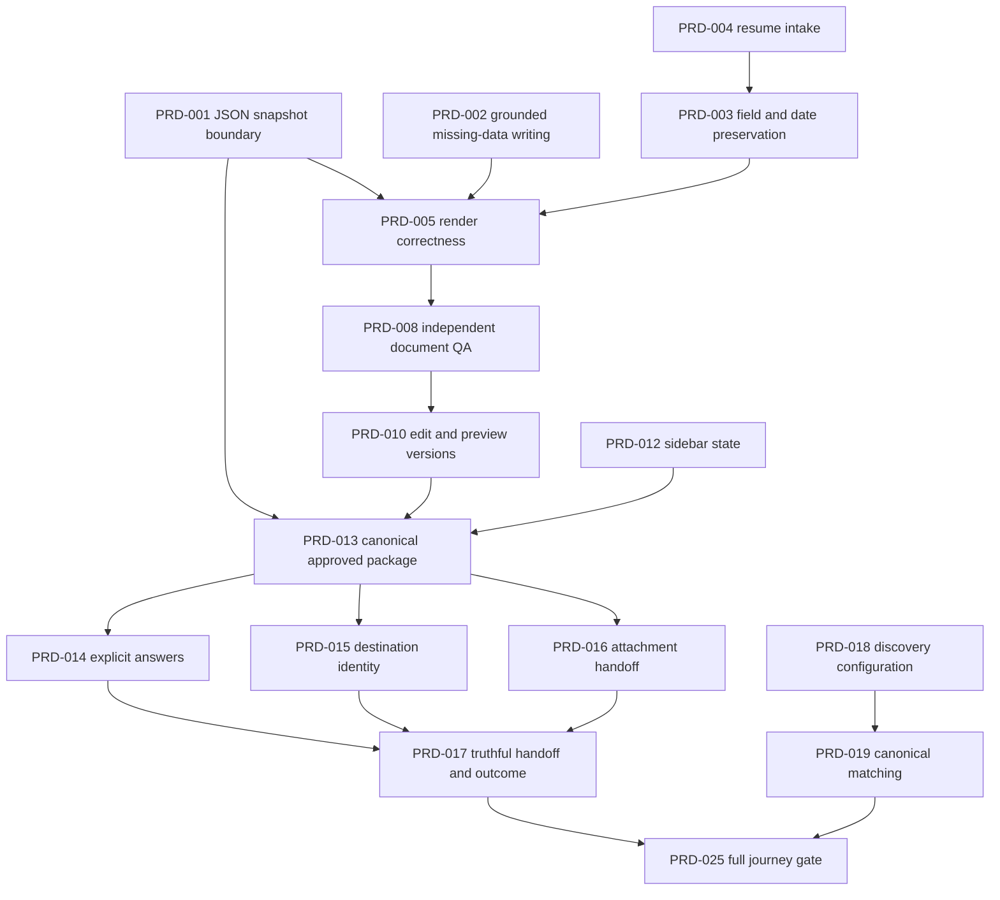

# Product repair roadmap

Audit: PRODUCT-AUDIT-001 (2026-10-09). Updated: 2026-10-10. **PRD-001 is COMPLETE (locally implemented/integration verified); all other proposed implementation tasks are NOT_STARTED.** Production remains NO-GO; separate existing release gates are unchanged. Scope aligns with `goal.md`: provider-neutral, evidence-backed career artifacts and human-approved external actions. [PRD-001 evidence and contract](prd-001-analysis-serialization.md): authenticated real HTTP preparation200, stable persisted hash/version and 175 focused PASS / 0 FAIL / 0 CANCEL / 0 SKIP. The defect descriptions below retain their original repair-plan context.

## Execution order and dependencies

Preferred sequence: structured inputs → correct generation/rendering → measured writing/ATS checks → preview/edit/download → reliable extension → prepared package/autofill → approved handoff/tracking → matching/other features → full journeys. P0 incorrect-field and wrong-destination reproductions should be protected immediately as the fill path is repaired; upstream breakage is not a reason to leave them present.

## Structured resume model and input correctness

| ID / priority    | Defect / affected journey / root cause                                                                                                                                                 | Exact modules                                                                                                                                                                 | Expected behavior and acceptance criteria                                                                                                                                                                                                                                                                                                                                                                | Relevant tests / dependencies                                                                                                                                                                                                       |
| ---------------- | -------------------------------------------------------------------------------------------------------------------------------------------------------------------------------------- | ----------------------------------------------------------------------------------------------------------------------------------------------------------------------------- | -------------------------------------------------------------------------------------------------------------------------------------------------------------------------------------------------------------------------------------------------------------------------------------------------------------------------------------------------------------------------------------------------------- | ----------------------------------------------------------------------------------------------------------------------------------------------------------------------------------------------------------------------------------- |
| **PRD-001 / P0** | Analysis→prepare returns500. PG `analyzedAt` Date is copied into3package analysis locations and violates strict canonical JSON hashing. Journeys6,10,11.                               | `src/services/job-analysis-snapshot.service.js:215`; `src/routes/extension.routes.js:1133`; `src/services/job-application-workflow.service.js:1373`; DTO schemas              | Normalize known timestamps to ISO strings at an explicit snapshot DTO boundary before package construction; preserve null/unknown values and semantics. Real persisted snapshot→prepare200→store/reload yields same canonical hash/version;0non-JSON values, no lossy global serializer. Keep canonicalPackageJson, signing and immutable snapshots strict.                                              | Existing extension prepare regression + new real PG timestamp/rehydration/hash roundtrip; include both answers/targetJob analysis paths. No dependency/migration expected; first task.                                              |
| **PRD-002 / P0** | Empty profile receives unsupported generic “Experienced…” biography despite no career facts. Final status is INFERRED, but text remains unsupported and receipt passes. Journeys1,4,5. | `resume-accomplishment-composer.service.js:824`; `structured-resume.service.js:1546,1938`; summary/writing prompt policies; acceptance gate                                   | Fresh and incomplete users get explicit missing-data guidance or a neutral candidate-authored objective. No experience, qualifications, achievement or metric unless traceable to supplied facts. Empty source facts cannot yield experience assertions; receipt identifies unsupported biography. Preserve actual source provenance, including INFERRED.                                                | New resume audit empty-profile characterization becomes desired-behavior test; fresh/student/career-switcher/experienced fixtures; real generated PDF text assertions. Depends on source fact inventory, independent of001.         |
| PRD-003 / P1     | Structured data loses current education, grade, certification detail, optional publications/awards/achievements; dates accept invalid/reversed chronology. Journeys2–6.                | `resume.schemas.js`; canonical candidate schema; `structured-resume.service.js:389,1623`; `master-resume-structure.service.js`; `date-range-normalizer.js`; profile ingestion | Define required identity/contact versus optional career sections. Preserve candidate-authored fields and IDs through profile→snapshot→render/export/reload. Normalize YYYY/YYYY-MM/full dates consistently; reject invalid months and reversed noncurrent ranges; preserve explicitly current enrollment. Custom sections have bounded content and source claim status. No schema default invents facts. | Date/education/optional-section audit cases + genuine profile save/reload and cross-format roundtrip. Dependency001DTO and source003contract decisions recorded in ledger before migration if needed.                               |
| PRD-004 / P1     | DOCX flattens paragraph boundaries, retains entities, cannot read ZIP descriptor entries; PDF globally sorts page streams; unreadable PDF becomes “Parsed PDF Document.” Journeys2,6.  | `resume-parser.service.js:429,527,568`; `source-resume-ingestion.service.js`; `web.routes.js:2355`; source review UI                                                          | Office-generated DOCX preserves paragraphs/bullets/entities and valid ZIP variants. Real PDF parser preserves page order/Unicode; textless scans return actionable unsupported/OCR-required state. No placeholder text approved as candidate data. Confidence/parse failure visible, original preserved. Choose focused maintained parser or narrow corrections after fixture investigation.             | New DOCX/PDF audit cases, valid office DOCX fixture corpus, independently extracted digital PDF, scanned PDF, encrypted/malformed input; HTTP upload→review→approve source lifecycle. No invented OCR result; scope OCR separately. |

## Resume generation, rendering, writing and ATS quality

| ID / priority | Defect / affected journey / root cause                                                                                                                                                                       | Exact modules                                                                                                           | Expected behavior and acceptance criteria                                                                                                                                                                                                                                                                                                                                                                                                   | Relevant tests / dependencies                                                                                                                                                                              |
| ------------- | ------------------------------------------------------------------------------------------------------------------------------------------------------------------------------------------------------------ | ----------------------------------------------------------------------------------------------------------------------- | ------------------------------------------------------------------------------------------------------------------------------------------------------------------------------------------------------------------------------------------------------------------------------------------------------------------------------------------------------------------------------------------------------------------------------------------- | ---------------------------------------------------------------------------------------------------------------------------------------------------------------------------------------------------------- |
| PRD-005 / P1  | Renderers omit certification detail and enrollment dates; Chrome fallback emits blank bullet from raw itemize preamble. Long/multipage and Unicode behavior need independent text/visual gates. Journeys3–7. | `latex-document-generator.service.js:608,637`; `latex-compiler.service.js:555`; layout engine; PDF observer/geometry/QA | All selected source sections appear once; no blank bullets; proper current/date formatting; issuer/date/credential preserved. Real fallback and available real TeX engine produce selectable text with intended order, intact Unicode, no overlaps/clipping, no lost roles/projects. Compiler errors are recoverable and explicit.                                                                                                          | Native4persona PDFs including9roles and long URL; independent PDF extraction/raster review; itemize-empty-preamble regression. Depends003;001unblocks route delivery.                                      |
| PRD-006 / P1  | 5template names are metadata; abstract renderer throws and canonical renderer ignores ID. Journeys1,3–6.                                                                                                     | `resume-presentation.service.js:107`; `resume.schemas.js` template IDs; TeX generator; resume/handoff views             | Ship one explicitly supported ATS-oriented template first, with accurate UI capability; or implement truly distinct templates behind verified renderers. No selectable name silently maps to unrelated identical style. Source-preservation mode describes actual limitations.                                                                                                                                                              | Template selection→stored version→actual PDF visual/text matrix; unsupported IDs produce clear error. Depends005; do not delay core correctness for decorative variants.                                   |
| PRD-007 / P2  | DOCX output absent although input parsing exists. Journey3.                                                                                                                                                  | `career-artifact-export.service.js`; export schemas; application artifact routes/storage                                | Scope a real editable DOCX export if required; preserve canonical sections, Unicode, real hyperlinks, bullets and dates. Download MIME/filename correct, only owned current/versioned artifact. Until implemented, UI accurately lists available PDF/TeX/text/JSON formats.                                                                                                                                                                 | Independently opened/rendered DOCX plus parser roundtrip and authorized download; stored hash/version parity. Depends003/005/010; new output dependency reviewed narrowly.                                 |
| PRD-008 / P1  | Internal QA can pass source-free prose; parser-dependent ATS/quality checks may miss real layout/text defects. Journeys1–7.                                                                                  | Acceptance/content/writing/quality/ATS-parseability services; PDF geometry validator; `evaluation/benchmark`            | Use measurable gates in resume audit:0unsupported claims/numbers,0missing selected fields,0duplicate/empty sections or bullets, valid dates, required contact intact, independent extraction/reading order,0clipping/overlap, readable fonts and deterministic page budget. Human grammar/tense relevance sample review supplements heuristics. Quality gates explain missing evidence rather than inventing content to meet bullet counts. | Golden persona/source corpus + independent parser/raster artifacts + adversarial long URL/Unicode/overflow/empty-data fixtures. Depends002–005. No mocked renderer acceptance.                             |
| PRD-009 / P1  | Review shows qaScore or fallback92 as “ATS Alignment”; Radar clamps raw overlap to25. Journeys6,11,15.                                                                                                       | `job-application-flow.service.js:683`; `apply.page.js:595`; `web.routes.js:5256`; scoring/explainability services       | Show document parseability, writing quality, evidence-backed job fit and keyword coverage separately. Missing/0remainmissing/0; canonical score breakdown shared by all surfaces. No employer/ATS pass probability or invented score without validated method/data.                                                                                                                                                                         | Rendering fixtures for unknown/0fit/failedQA; same job/profile web/MCP/extension parity; verify denominator/component sums and truthful labels. Depends canonical fit contract; no security-policy change. |

## Preview, editing and downloads

| ID / priority | Defect / affected journey / root cause                                                                                                                                             | Exact modules                                                                                                                  | Expected behavior and acceptance criteria                                                                                                                                                                                                                                                                                                                                 | Relevant tests / dependencies                                                                                                                                                                                                 |
| ------------- | ---------------------------------------------------------------------------------------------------------------------------------------------------------------------------------- | ------------------------------------------------------------------------------------------------------------------------------ | ------------------------------------------------------------------------------------------------------------------------------------------------------------------------------------------------------------------------------------------------------------------------------------------------------------------------------------------------------------------------- | ----------------------------------------------------------------------------------------------------------------------------------------------------------------------------------------------------------------------------- |
| PRD-010 / P1  | Generated section/bullet editor and standalone create/preview/download flow missing; source edits are narrow. Approval UI does not normally issue required ticket. Journeys1,3,11. | `resumes.page.js`, `handoff.page.js`, `apply.page.js:648`; `web.routes.js:3918,4442,4494,4614,4789`; snapshot/version services | User edits canonical candidate-owned claim content, sees rendered exact version, saves a new version, downloads identical reviewed bytes and explicitly approves hash/version. Editing never mutates previously approved package; changed version invalidates/requires new approval. Fresh review has normal explicit request-approval control; no ticket URL workaround. | Real browser+HTTP+PG create→edit→render→download→approve→change→reapprove; byte/hash fidelity, revoked/cross-tenant/deleted/stale version failures. Depends001/003/005/008; preserve immutable/signed content and provenance. |

## Extension reliability and application assistance

| ID / priority    | Defect / affected journey / root cause                                                                                                                                      | Exact modules                                                                                                  | Expected behavior and acceptance criteria                                                                                                                                                                                                                                                                                   | Relevant tests / dependencies                                                                                                                                                                         |
| ---------------- | --------------------------------------------------------------------------------------------------------------------------------------------------------------------------- | -------------------------------------------------------------------------------------------------------------- | --------------------------------------------------------------------------------------------------------------------------------------------------------------------------------------------------------------------------------------------------------------------------------------------------------------------------- | ----------------------------------------------------------------------------------------------------------------------------------------------------------------------------------------------------- |
| PRD-011 / P2     | Unpacked extension configuration defaults localhost; unbundled browser cannot use production process.env logic. Install/login/session full path not verified. Journeys8–13. | `extension/config.js`, manifest, worker, auth client, backend client; package scripts                          | Reproducible intended-origin build artifact and clear first-run configuration/auth state. Correct sign-in/expiration/reconnect behavior and API synchronization. Preserve allowed origins, cookies/authentication and backend pinning.                                                                                      | Disposable Chrome MV3 install with local backend; login/reload/session-expiry/offline recovery; permission inventory matches actual capability. Depends browser harness025, no deployment.            |
| PRD-012 / P1     | Duplicate sidebar methods overwrite persistence/workflow updates and read fields never stored; stale SPA/tab races can hide real detection. Journeys8,9,12.                 | `sidebar.js:1083,1512,1776,2320`; workflow store; content/worker messages                                      | One authoritative handler per event; normalized durable tab/form state; preview uses detected fields. Per-job identity survives reload/navigation and old messages cannot replace new job. Retry/double-click bounded and cancelable.                                                                                       | New handler/preview observations become behavioral tests; actual MV3 tabs/reload/SPA/dynamic forms and duplicate event fixture; no hand-injected package shortcuts. Independent prerequisite for013.  |
| PRD-013 / P1     | Prepare returns IDs/artifact metadata but sidebar treats whole response as canonical candidate package. Journeys10–13.                                                      | `extension.routes.js:1171`; `sidebar.js:1580`; `backend-client.js:269`; authoritative package/preview services | Retrieve owned server-stored exact package by application/hash/version; use approved content for preview/answers/fill. No stale live-profile fallback after approval. IDs and hash remain consistent across web/MCP/extension. Errors expose actionable cause safely, no silent retry or new approval on UNKNOWN execution. | Real session→prepare→preview→issue approval→content-script DTO→native form; profile changes after approval do not alter approved values. Depends001/010/012; preserve at-most-once boundary.          |
| **PRD-014 / P0** | Missing authorization becomesYes and sponsorshipNo after generic consent, stamped VERIFIED_PROFILE. Journey12 risks incorrect answers.                                      | Browser generic engine `:421,430,580`; `content-script.js:785`; server mapping schemas                         | Missing staysmissing/REVIEW after checkbox confirmation. Explicit candidate-provided authorization/sponsorship only; field-specific interpretation and consent, provenance retained. No inference from location/name. Critical answers require review even where automation is assisted.                                    | Empty/false/true/nested-careerPreferences fixtures, native select/radio/custom-widget tests; approved payload→filled value parity. Depends013 for whole flow; isolated safety regression immediately. |
| **PRD-015 / P0** | Destination checker accepts same-host different-job pages and malformed URLs. Journey12 risks wrong package at wrong employer/role.                                         | `sidebar.js:1742`; `lib/job-identity.js`; canonical URL/job identity; backend destination guards               | Job A package cannot fill Job B on same ATS domain. Re-check approved canonical job/destination before any DOM mutation; explicitly model valid multi-step employer transitions, unknown/malformed target blocks for review.                                                                                                | Samecompany2jobs, crosscompanysharedhost, SPA navigation, query tracking and allowed wizard routes;0DOM mutations on mismatch. Depends013; keep existing server approval binding.                     |
| PRD-016 / P1     | Attachment is dataset marker, native input empty; completion ignores failed uploads and missing required fields. Journeys3,12,13.                                           | Browser generic engine `:541,705,759`; server generic engine `:944`; sidebar result rendering                  | First implement truthful manual-upload-required result with immutable download link. Only claim uploaded after genuine FileList/content/name/MIME/hash validation on supported forms. Report partial fills, failed/readonly/custom widgets and required missing fields; never click final submit.                           | Actual native file/text/select/radio DOM with real approved artifact bytes; no employer request; readonly/multi-step/oversize failure cases. Depends005/013; download auth/provenance unchanged.      |

## Human-approved handoff, matching and remaining features

| ID / priority   | Defect / affected journey / root cause                                                                                                            | Exact modules                                                                                                             | Expected behavior and acceptance criteria                                                                                                                                                                                                                                                                                                                                              | Relevant tests / dependencies                                                                                                                                                                                               |
| --------------- | ------------------------------------------------------------------------------------------------------------------------------------------------- | ------------------------------------------------------------------------------------------------------------------------- | -------------------------------------------------------------------------------------------------------------------------------------------------------------------------------------------------------------------------------------------------------------------------------------------------------------------------------------------------------------------------------------- | --------------------------------------------------------------------------------------------------------------------------------------------------------------------------------------------------------------------------- |
| PRD-017 / P1    | HANDOFF_READY redirect says submitted; built-in adapter capability claims exceed actual receipt implementation. Journeys11,13,14.                 | `web.routes.js:3883`; workflow/flow/state services; portal adapters; handoff/apply/application views                      | Ready/staged/manual-handoff, user-attested applied, and employer-confirmed submission displayed distinctly. Manual outcome record requires explicit user action and source/timestamp. Built-ins remain handoff-only; UNKNOWN execution blocks replay. No adapter represented real unless exact authorized submission and receipt verified.                                             | Approved package→handoff→user attestation→tracking real PG/browser test; noAPPLIED/appliedAt on prepare; controlled injected receipt success/failure without actual employer traffic. Depends010/013–016.                   |
| PRD-018 / P1    | Web discovery constructs0providers while MCP reads configured board/site lists. Journeys8,9 and search.                                           | `web.routes.js:5236`; `job-discovery.service.js:554`; `job-workflow-tools.js:79`; adapters                                | Shared injectable configured discovery instance;0providerconfiguration/outage distinguished from genuine0matches. Current source attribution/dedup/freshness maintained; no synthetic production fallback.                                                                                                                                                                             | Controlled real HTTP Greenhouse/Lever response servers→actual adapter→web/MCP feeds; retries/timeouts/malformed/stale/sourcejob tests; live read acceptance separately if authorized. No dependency on employer submission. |
| PRD-019 / P2    | Web overlap differs from canonical fit; dashboard “recommendations” are recent applications; eligibility/salary unknowns need explicit treatment. | Web dashboard/radar projections; evidence matching/ATS fit/discovery rank/preference services                             | Show recent applications separately; discovered recommendations ranked by explained canonical fit and known eligibility. Normalize salary currency/period only from real data; unknown noteligible/no0default. Consistent job/profile result across3surfaces.                                                                                                                          | 0/full/partial/synonymskills, unknowneligibility, salarycurrency/period, stale jobs, same-companydistinctjobs; parity integration. Depends018/009.                                                                          |
| PRD-020 / P1    | Dashboard uses absent career-profile skills/projects/resources fields.                                                                            | `web.routes.js:301,395`; `candidate-profile.service.js:2526`; `dashboard.page.js`                                         | Explicit view model maps topSkills/highlightedProjects and actual authorized source count; project names/links/skill totals visible, no empty profile fallback on load error.                                                                                                                                                                                                          | Existing real HTTP/PG cloud-mesh-kernel failure passes unchanged; fresh profile and loader-timeout tests; compare `/projects` and dashboard identities. Independent small repair.                                           |
| PRD-021 / P1    | MCP job dossier passes context instead of `{jobId}`. Journey15.                                                                                   | `career-resources.js:285`; `job-discovery.service.js:815`; canonical posting lifecycle                                    | Resource resolves same source-attributed posting as tool search/get; scope remains enforced; missing/stale posting has accurate typed error.                                                                                                                                                                                                                                           | Retained desired-contract `other-feature-journeys.test.js` passes; real HTTP tools/search→resources/read roundtrip. Depends018 for feed contract; direct service signature repair independent.                              |
| PRD-022 / P2    | Portfolio compact output discards interview topics/case studies; hosted portfolio/interview trainer absent.                                       | `career-artifact-tools.js:693`; portfolio service `:1277`; export schemas/views                                           | Preserve bounded existing evidence-based topics/case-study recommendations and expose clear preview/export. Accurately label recommendation document. Hosted site and dedicated interview trainer are separately scoped future features, not repair completion.                                                                                                                        | Applicable project produces nonempty topics through real MCP serialization; no unsupported accomplishments; exported document matches. Independent.                                                                         |
| PRD-023 / P2    | Restart loses ingestion state/proposal review; push events ignored.                                                                               | `ingestion-state.service.js:25`; `web.routes.js:1276`; assistant pending Map; GitHub webhook service                      | Establish required product recovery semantics before storage work: interrupted state visible, bounded idempotent retry, no duplicate writes. Persist only needed owned run/proposal state if approved requirement; accurate manual-sync status if push sync remains unsupported.                                                                                                       | Restart/interruption/duplicate webhook/multireplica controlled fixtures with real persistence where implemented; lost pending proposal cannot silently execute. Scope narrowly, no speculative infrastructure.              |
| PRD-024 / P2–P3 | Schema/writer4static findings, obsolete inventory copy/tests, invalid final MCP source fixture and forged-package message assertion.              | `schema.js:1187`; extractor `:167`; final MCP fixture `:234,276,405`; P86 and workflow remediation tests; settings `:154` | Repair fixtures with authorized candidate-bound/pinned sources and valid sealed content; current30tool inventory derived. Assert approval-required/truthful handoff instead of legacy APPLIED. Measure FK query access before narrow reversible indexes; maintain updatedAt. No provenance/scope guard or assertion deleted to make green.                                             | Final transport0cancel; schema0blockers; exact unchanged guards; fixture migration22 and lifecycle teardown; count copy renderer. Independent test repair can unblock broader diagnosis.                                    |
| PRD-025 / P1    | No proven all15journey gate; MV3 CDP setup cancels, mock backend shape differs from real prepare.                                                 | `tests/product/*`; `tests/e2e/phase9-2-extension-runtime.test.js`; integration fixtures; audit runner                     | Stable hidden disposable browser+local Fastify+empty PostgreSQL fixture. Each of15journeys reports real exercised boundaries, live-dependency limits separately. Native attachments/manual handoff, exact approved bytes, actual status semantics, source parsing/render QA and MCP resources exercised without mocked DTO shortcuts.0unexpectedfail/0cancel; no real employer submit. | Matrix in full-feature audit. Depends001–022 and024fixture fixes. TeX/AI/GitHub/provider read integrations require separate disposable/live acceptance, never called mock proof.                                            |

## First completed repair and next recommended task

**PRD-001: COMPLETE locally.** Known snapshot/analysis timestamps normalize into canonical UTC JSON before package construction, with validation and real timestamp-backed HTTP/PG hash/version round trips. The canonicalizer, provenance, approval bindings, already approved snapshots and signing protections remain unchanged.

**PRD-003: COMPLETE locally (2026-10-10), explicitly selected by the user next.** Canonical source normalization and compatible JSONB schemas preserve education, credentials, optional sections and IDs through save/read/edit/package/preview/TeX/PDF. Real PostgreSQL, authenticated HTTP and Chrome output acceptance is recorded in [the repair record](prd-003-structured-resume-completeness.md) and project.md. No database migration or approval-security change. Directly necessary fixes also remove blank bullets/literal-symbol loss and Unicode download HTTP500; remaining PRD-005 layout/template work is open.

**Next recommended task: PRD-002 — source-grounded missing-data writing.** The empty-profile summary guard is a narrow PRD-003 prerequisite; the broader writing repair is NOT_STARTED. PRD-004 parser formats, PRD-005 readability/pagination, PRD-007 DOCX, PRD-010 editor and legacy export adapter acceptance remain open. Local repairs do not establish installed-browser, live-provider or release acceptance; no production deployment.

## Stop conditions and release distinction

Each repair closes only its stated defect after real relevant checks and a `project.md` entry. Do not expand a parser/DTO/UI patch into broad security architecture or new autonomous submission infrastructure. Product readiness requires all required15journeys, accepted artifact quality, truthful status/score UX and supported-platform boundary coverage. Release readiness additionally requires the separate outstanding security/hosted/operational gates. Neither this audit nor a passing local repair changes NO-GO or any project completion percentage.
